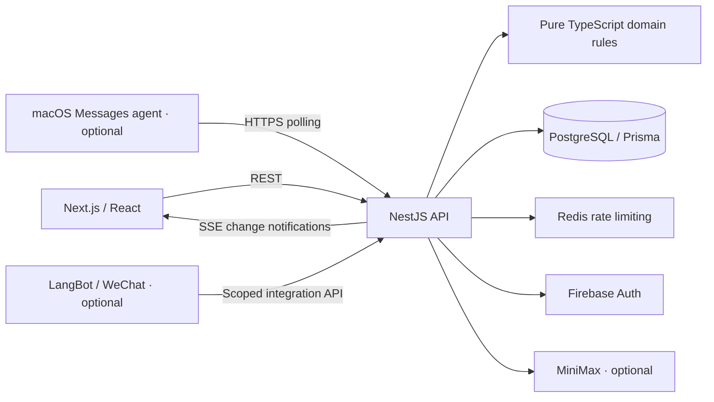

# Massage Note

**English** | **[简体中文 · 中文说明](README.zh-CN.md)**

[](https://github.com/Redonkatonkk/massage-note/actions/workflows/ci.yml)

**[Latest release](https://github.com/Redonkatonkk/massage-note/releases/latest)** · **[Changelog](CHANGELOG.md)**

Current version: `1.50.0`

A full-stack TypeScript application for massage shop operations in the United States, with an English/Chinese interface for phones, tablets, and desktops. It connects service records, split payments, employee commissions, daily closing, payroll tracking, and business analytics in one auditable workflow.

**[Engineering highlights](#engineering-highlights)** · **[Architecture](#architecture)** · **[Run locally](#run-locally)** · **[Explore the code](#explore-the-code)** · **[Documentation](#documentation)**

## Live demo and page gallery

**[Open the sign-in-free demo](https://redonkatonkk.github.io/massage-note/)** · **[All 17 page previews](docs/portfolio/README.md)**

Explore the original UI with synthetic data, in English or Chinese. Browse work records, financial analytics and management workflows. The public demo is read-only; real sign-in, saves, AI and message delivery are disabled. [One-minute walkthrough and limitations](docs/portfolio/README.md#a-one-minute-walkthrough).

| Work board | Business analytics |
| --- | --- |
|  |  |

<a id="解决的问题"></a>

## The problem

A single service can combine a discount, an add-on, cash, a card payment, a gift card, and a tip. Employee earnings must remain explainable when prices or commission rules change later. Massage Note keeps the original service and pricing snapshots, separates earned income from actual payroll payments, and checks permissions and financial rules on the server.

<a id="当前能力"></a>

## What it does

- **Daily operations:** today and historical work boards, employee attendance and opening order, service durations, add-ons, discounts, payment confirmation, and recoverable deletion.
- **Financial workflows:** cash/card/gift-card splits, commissions, daily closing, cash settlement, employee payroll ledgers, date-range statements, monthly financial comparisons, and CSV exports.
- **Business analytics:** revenue trends, weekday comparisons, service activity heatmaps, recurring expenses, and one-time expenses.
- **Multiple stores and roles:** Owner, Manager, and Employee access, membership approval, store switching, and employee-specific financial visibility.
- **Bilingual access across devices:** responsive English/Chinese screens, live change notifications, temporary form drafts, and downloadable employee statement images.
- **Optional integrations:** a MiniMax text/voice assistant, a LangBot WeChat work-record plugin, and a macOS Messages agent for employee statements. Core manual workflows remain available without an AI provider.

<a id="工程重点"></a>

## Engineering highlights

| Concern | Implementation |
| --- | --- |
| Financial correctness | Integer-cent calculations in pure domain functions, database constraints, and saved price/commission snapshots preserve historical calculations. |
| Concurrent edits and closing | Transaction-scoped PostgreSQL advisory locks coordinate business-day writes; resource versions detect stale edits, and idempotency keys protect critical operations from replay. |
| Traceable state changes | Business data, audit records, and outbox events are written in the same transaction. Soft deletion preserves a recovery path. |
| Store and employee isolation | API services check active membership, role, store scope, and object ownership. Integration tests exercise access boundaries. |
| Reliable synchronization | SSE events tell clients to refetch authoritative REST data. Refreshes are coalesced, and stale requests are discarded after store changes or unmounting. |
| Controlled AI writes | The web assistant produces a server-stored preview. Confirmation rechecks authorization and consumes the preview once; financial totals come from deterministic queries. |
| Deployment and recovery | CI verifies the code and builds a NAS image in parallel, then promotes the same image digest to immutable version tags. Compose, database account hardening, backup, and recovery tooling are included. |

<a id="系统架构"></a>

## Architecture

A pnpm workspace organized as a modular monolith, with separate web/API applications and shared domain, contract, and persistence packages.



PostgreSQL is the source of truth. SSE carries change notifications, and clients reload the relevant data through REST. The API owns authorization, transactions, and final financial calculations; the web app handles presentation and interaction. Shared Zod contracts validate inputs across application boundaries.

| Layer | Technology |
| --- | --- |
| Web | Next.js 16, React 19, TypeScript, responsive CSS |
| API | NestJS 11, REST, Server-Sent Events, Zod |
| Persistence | PostgreSQL 17, Prisma, forward-only migrations |
| Identity and request controls | Firebase Auth, HttpOnly session cookies, CSRF/origin checks, Redis 8 rate limiting |
| Verification | Vitest, React/jsdom component tests, database/API integration tests, repository checks |
| Delivery | Node.js 24, pnpm 11, Docker Compose, GitHub Actions, GHCR, Synology NAS |

```text
apps/
  web/              Responsive bilingual UI and API client
  api/              Authentication, authorization, REST, SSE, transactions
  messages-agent/   Statement rendering and macOS Messages delivery
packages/
  domain/           Pure financial, commission, date, and permission rules
  contracts/        Shared Zod schemas and TypeScript types
  database/         Prisma schema, migrations, and database tests
integrations/
  langbot-plugin/   WeChat work-record integration and Python tests
docker/             Database hardening and NAS startup
scripts/            Verification, demo data, backup, and recovery tooling
docs/               Product, engineering, operations, and archived decisions
```

<a id="本地运行"></a>

## Run locally

Requires **Node.js 24**, **pnpm 11.9.0**, and **Docker with Compose**. Default local ports are 3000 (web), 4000 (API), 5432 (PostgreSQL), and 6379 (Redis).

```bash
git clone https://github.com/Redonkatonkk/massage-note.git
cd massage-note
cp .env.example .env
pnpm install
```

For a local demo without Firebase, set these values in `.env`:

```dotenv
NEXT_PUBLIC_DEV_AUTH_ENABLED=true
DEV_AUTH_ENABLED=true
DEV_AUTH_SECRET=replace-with-a-local-random-secret-at-least-32-characters
```

Generate your own secret with `openssl rand -hex 32`. Development login is disabled in production. Firebase is needed for normal phone/password authentication; MiniMax credentials are optional for the assistant.

```bash
pnpm docker:up
pnpm db:generate
pnpm db:deploy
```

For a **fresh local demo database**, optionally run `pnpm demo:seed`. This creates synthetic shop records with the fixed local demo phone number `7705750450`; it is an explicit setup step, not part of normal startup. Existing developer databases may contain authorized business snapshots and should be preserved; see the [development guide](docs/engineering/DEVELOPMENT.md#local-manual-test-data) before replacing local data.

```bash
pnpm dev
```

Open **[localhost:3000](http://localhost:3000)**, select English with the language switcher, and use the development login with `7705750450` when using the demo seed. The seed uses Chinese sample names; the interface language can be switched independently.

Readiness can be checked from the command line:

```bash
curl --fail http://localhost:3000
curl --fail http://localhost:4000/api/v1/health/ready
```

<a id="代码阅读入口"></a>

## Explore the code

| Start here | What to look for |
| --- | --- |
| [Domain rules](packages/domain/src) and [tests](packages/domain/test) | Integer-cent arithmetic, commission precedence, settlement rules, and business dates. |
| [Shared contracts](packages/contracts/src) | Validated inputs shared between the web app and API. |
| [Database schema](packages/database/prisma/schema.prisma) and [migrations](packages/database/prisma/migrations) | Financial snapshots, audit/outbox tables, constraints, and schema evolution. |
| [Business-day locks](apps/api/src/common/business-day-lock.ts) and [idempotency service](apps/api/src/common/idempotency.service.ts) | Coordination of competing writes and repeated requests. |
| [Finance integration tests](apps/api/test/finance.integration.test.ts) and [membership integration tests](apps/api/test/memberships.integration.test.ts) | Financial behavior and store/role access boundaries against a database. |
| [Realtime API](apps/api/src/realtime) and [refresh queue](apps/web/lib/refresh-queue.ts) | Outbox-driven notifications and coordinated client refreshes. |
| [AI module](apps/api/src/ai) | Conversation scope, deterministic queries, previews, and confirmed changes. |
| [CI workflow](.github/workflows/ci.yml) | Verification, parallel image builds, and versioned image promotion. |

<a id="验证"></a>

## Verification

```bash
pnpm version:check
pnpm docs:check
pnpm typecheck
pnpm test
pnpm test:integration
pnpm build
```

Integration tests use a separate `massage_note_test` database. The suite covers domain rules, contracts, API behavior, database constraints, web helpers/components, and the Messages agent. The LangBot plugin has a separate Python suite: `python3 -m unittest discover -s integrations/langbot-plugin/tests -v`.

These are the full development checks; select checks appropriate to each change. NAS releases follow the [deployment workflow](docs/operations/NAS_DEPLOYMENT.md#default-update-deployment-process), which reuses CI verification rather than repeating the full suite locally.

<a id="项目文档"></a>

## Documentation

This README is the English project overview. Product, engineering, operations, recovery, plugin, and archived documentation is available in matching English and Chinese editions. English is the default; use the language link at the top of each document to switch.

- **[中文 README](README.zh-CN.md)** — Chinese version of this overview.
- [Documentation index](docs/README.md) — all current manuals and archived decisions.
- [Product rules](docs/product/PRODUCT.md) — roles, workflows, and financial definitions.
- [Architecture](docs/engineering/ARCHITECTURE.md) · [API reference](docs/engineering/API.md) · [Development guide](docs/engineering/DEVELOPMENT.md).
- [UI design](docs/engineering/UI_DESIGN.md) — visual conventions and mobile reading order.
- [Docker deployment](docs/operations/DEPLOYMENT.md) · [NAS deployment](docs/operations/NAS_DEPLOYMENT.md).
- [Operations](docs/operations/OPERATIONS.md) · [Security](docs/operations/SECURITY.md) · [Release checklist](docs/operations/RELEASE_CHECKLIST.md).
- [Messages agent](docs/operations/MESSAGES_AGENT.md) · [LangBot integration](docs/operations/LANGBOT_WORK_BOT.md).
- [Maintainer handoff](docs/engineering/AI_HANDOFF.md) · [Changelog](CHANGELOG.md).

<a id="实现范围"></a>

## Scope

Massage Note records shop operations and tracks earnings and payroll payments. Appointment scheduling, card processing, payroll tax calculation, and tax filing are outside the current implementation. Employee statement submission is tracked separately from confirmed delivery.

Owners can move interview/demo data using a single full or anonymized JSON file in **Management → Data operations**. See [store data files](docs/operations/OPERATIONS.md#store-data-files) for import and recovery instructions. Anonymized files retain real amounts and dates.
