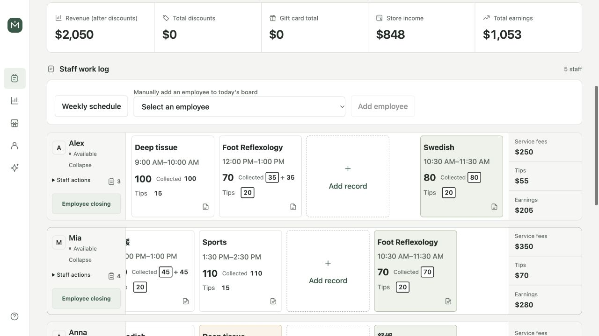
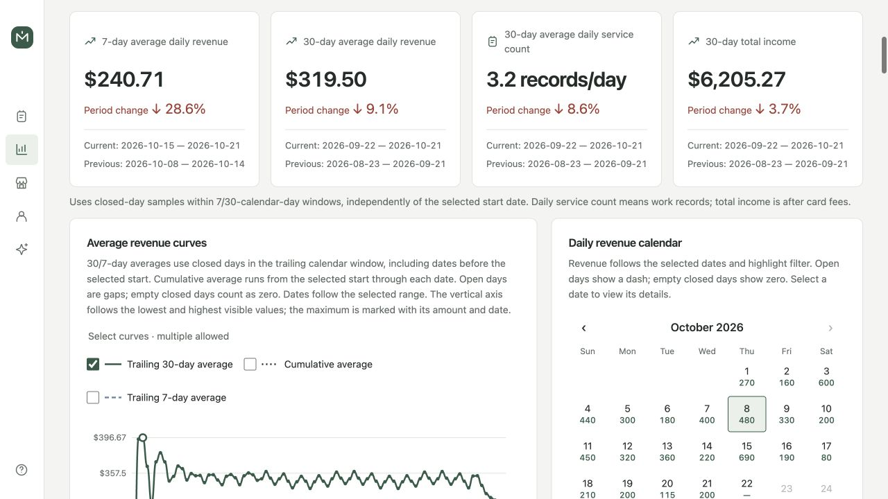
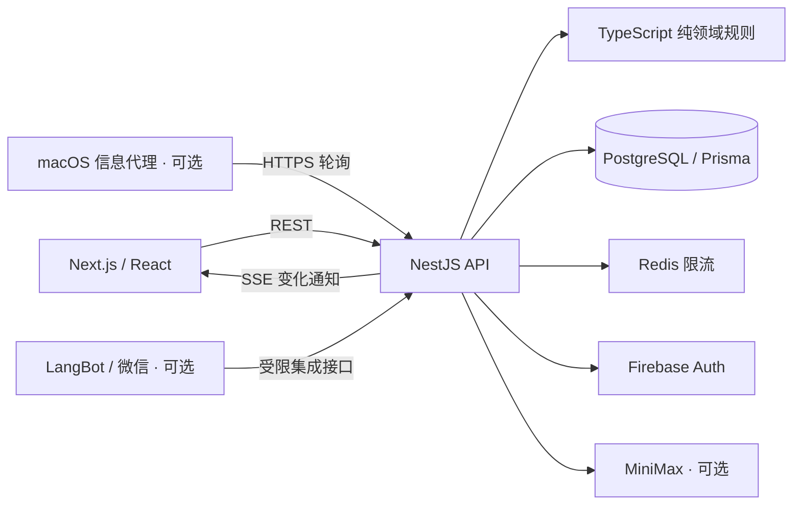

# Massage Note

**[English · 英文说明](README.md)** | **简体中文**

[](https://github.com/Redonkatonkk/massage-note/actions/workflows/ci.yml)

**[最新正式版](https://github.com/Redonkatonkk/massage-note/releases/latest)** · **[更新记录](CHANGELOG.zh-CN.md)**

当前版本：`1.47.0`

面向美国按摩店的全栈 TypeScript 管理应用，提供适配手机、平板和电脑的中英文界面，把记工、混合付款、员工提成、日结、工资支付登记和经营分析串成可追溯的业务流程。

**[工程重点](#工程重点)** · **[系统架构](#系统架构)** · **[本地运行](#本地运行)** · **[代码阅读入口](#代码阅读入口)** · **[项目文档](#项目文档)**

## 在线演示与页面展示

**[打开免登录 Demo](https://redonkatonkk.github.io/massage-note/)** · **[全部 17 个页面展示](docs/portfolio/README.zh-CN.md)**

演示复用真实界面，使用虚构数据，默认英文并支持切换中文。可浏览记工、财务分析和管理流程；数据只读，真实登录、保存、AI 与消息发送禁用。[一分钟演示路线与限制](docs/portfolio/README.zh-CN.md#一分钟演示路线)。

| 今日记工 | 经营分析 |
| --- | --- |
|  |  |

## 解决的问题

一笔服务可能同时包含折扣、额外项目、现金、刷卡、礼物卡和小费。后续调整价格或提成规则时，历史收入仍应能够解释和核对。Massage Note 保存服务、价格和提成快照，区分员工应得收入与实际工资支付，并在服务端验证权限和财务规则。

## 当前能力

- **日常经营：** 今日与历史记工看板、员工出勤和开门排位、多时长服务、额外项目、折扣、付款确认与删除恢复。
- **财务流程：** 现金／刷卡／礼卡混合付款、提成、日结、现金结清、工资账本、区间结算资料、月度财务对比与 CSV 导出。
- **经营分析：** 营业额趋势、星期对比、服务时段热图、周期支出与一次性支出。
- **多店与权限：** Owner、Manager、Employee 角色、加入审批、店铺切换与员工个人财务隔离。
- **中英文多设备使用：** 响应式界面、实时变化通知、限时表单草稿和员工收入图片下载。
- **可选集成：** MiniMax 文字／语音助手、LangBot 微信记工插件及 macOS“信息”员工资料发送代理；未配置 AI 时仍可手工记工和查账。

## 工程重点

| 问题 | 实现方式 |
| --- | --- |
| 财务准确性 | 纯领域函数使用整数美分计算，结合数据库约束及价格／提成快照保留历史计算依据。 |
| 并发修改与关账 | PostgreSQL 事务级 advisory lock 协调同一营业日写入；资源版本检测过期修改，关键操作使用幂等键防重放。 |
| 变化追溯 | 业务数据、审计与 outbox 事件在同一事务提交，软删除保留恢复路径。 |
| 店铺与员工隔离 | API 服务检查有效成员、角色、店铺范围与对象归属，集成测试覆盖访问边界。 |
| 实时同步 | SSE 通知客户端重新读取权威 REST 数据，合并刷新请求，切店或卸载后丢弃过期响应。 |
| AI 写入控制 | Web 助手先生成服务端保存的预览，用户确认后重新鉴权并一次性消费；财务金额来自确定性查询。 |
| 部署与恢复 | CI 并行验证和构建 NAS 镜像，再把同一 digest 发布为不可变版本标签；提供 Compose、数据库账号加固及备份恢复工具。 |

## 系统架构

采用 pnpm workspace 管理的模块化单体，Web/API 分为独立应用，领域、契约与持久化能力由共享包承载。



PostgreSQL 是业务真相来源；SSE 只发送变化通知，客户端通过 REST 重读相关数据。API 负责权限、事务与最终财务计算，Web 负责展示和交互；共享 Zod 契约在应用边界校验输入。

| 层次 | 技术 |
| --- | --- |
| Web | Next.js 16、React 19、TypeScript、响应式 CSS |
| API | NestJS 11、REST、Server-Sent Events、Zod |
| 数据 | PostgreSQL 17、Prisma、只向前追加的迁移 |
| 身份与请求控制 | Firebase Auth、HttpOnly 会话 Cookie、CSRF／Origin 校验、Redis 8 限流 |
| 验证 | Vitest、React/jsdom 组件测试、数据库／API 集成测试与仓库检查 |
| 交付 | Node.js 24、pnpm 11、Docker Compose、GitHub Actions、GHCR、群晖 NAS |

```text
apps/
  web/              中英文响应式 UI 与 API 客户端
  api/              认证、授权、REST、SSE 与事务编排
  messages-agent/   员工资料渲染与 macOS“信息”发送
packages/
  domain/           金额、提成、日期与权限纯函数
  contracts/        共享 Zod 契约和 TypeScript 类型
  database/         Prisma schema、迁移和数据库测试
integrations/
  langbot-plugin/   微信记工集成与 Python 测试
docker/             数据库加固与 NAS 启动入口
scripts/            验证、演示数据、备份及恢复工具
docs/               产品、工程、运维与归档决策
```

## 本地运行

需要 **Node.js 24**、**pnpm 11.9.0** 与 **Docker Compose**。默认端口为 Web 3000、API 4000、PostgreSQL 5432、Redis 6379。

```bash
git clone https://github.com/Redonkatonkk/massage-note.git
cd massage-note
cp .env.example .env
pnpm install
```

不配置 Firebase 的本地演示，可在 `.env` 中设置：

```dotenv
NEXT_PUBLIC_DEV_AUTH_ENABLED=true
DEV_AUTH_ENABLED=true
DEV_AUTH_SECRET=replace-with-a-local-random-secret-at-least-32-characters
```

使用 `openssl rand -hex 32` 生成自己的随机密钥。开发登录在生产环境强制关闭；正常手机号／密码认证需要 Firebase，助手的 MiniMax 凭据为可选项。

```bash
pnpm docker:up
pnpm db:generate
pnpm db:deploy
```

仅在**新建的本地演示数据库**中，可选执行 `pnpm demo:seed`，创建合成店铺数据和固定本机测试号码 `7705750450`；该步骤需要主动运行，不会随日常启动自动执行。现有开发库可能包含授权业务快照，应默认保留；替换前先看[开发指南](docs/engineering/DEVELOPMENT.zh-CN.md#本地手工测试数据)。

```bash
pnpm dev
```

访问 **[localhost:3000](http://localhost:3000)**，通过语言切换器选择中文或 English。使用演示种子时，输入 `7705750450` 并选择开发登录入口；种子使用中文示例姓名，界面语言可以独立切换。

命令行就绪检查：

```bash
curl --fail http://localhost:3000
curl --fail http://localhost:4000/api/v1/health/ready
```

## 代码阅读入口

| 入口 | 重点 |
| --- | --- |
| [领域规则](packages/domain/src)与[测试](packages/domain/test) | 整数美分、提成优先级、结算规则与营业日。 |
| [共享契约](packages/contracts/src) | Web/API 共用的输入校验。 |
| [数据库结构](packages/database/prisma/schema.prisma)与[迁移](packages/database/prisma/migrations) | 财务快照、审计／outbox、约束与结构演进。 |
| [营业日锁](apps/api/src/common/business-day-lock.ts)与[幂等服务](apps/api/src/common/idempotency.service.ts) | 并发写入及重复请求的协调。 |
| [财务集成测试](apps/api/test/finance.integration.test.ts)与[成员集成测试](apps/api/test/memberships.integration.test.ts) | 数据库上的财务行为和店铺／角色访问边界。 |
| [实时 API](apps/api/src/realtime)与[刷新队列](apps/web/lib/refresh-queue.ts) | outbox 驱动的通知与客户端合并刷新。 |
| [AI 模块](apps/api/src/ai) | 会话范围、确定性查询、预览与确认写入。 |
| [CI 工作流](.github/workflows/ci.yml) | 验证、并行镜像构建与版本化发布。 |

## 验证

```bash
pnpm version:check
pnpm docs:check
pnpm typecheck
pnpm test
pnpm test:integration
pnpm build
```

集成测试使用独立的 `massage_note_test` 数据库。测试范围包括领域、契约、API 行为、数据库约束、Web 辅助函数／组件和 Mac 代理；LangBot 插件另有 Python 测试：`python3 -m unittest discover -s integrations/langbot-plugin/tests -v`。

以上是开发阶段的完整检查入口，每次修改按影响选择必要验证。NAS 发布遵循[默认更新部署流程](docs/operations/NAS_DEPLOYMENT.zh-CN.md#默认更新部署流程)，复用 CI 验证，不在本地重复执行完整检查。

## 项目文档

仓库默认首页与各手册使用英文，本文件提供对应的中文概览；产品、工程、运维、恢复工具、插件和归档文档均提供内容对应的中文版本，顶部链接可切换语言。

- **[English README](README.md)** — 英文项目首页。
- [文档索引](docs/README.zh-CN.md) — 当前手册和归档决策。
- [产品规则](docs/product/PRODUCT.zh-CN.md) — 角色、业务流程和金额定义。
- [架构](docs/engineering/ARCHITECTURE.zh-CN.md) · [API](docs/engineering/API.zh-CN.md) · [开发指南](docs/engineering/DEVELOPMENT.zh-CN.md)。
- [UI 设计与审美准则](docs/engineering/UI_DESIGN.zh-CN.md) — 视觉约定与手机阅读顺序。
- [Docker 部署](docs/operations/DEPLOYMENT.zh-CN.md) · [NAS 部署](docs/operations/NAS_DEPLOYMENT.zh-CN.md)。
- [运维](docs/operations/OPERATIONS.zh-CN.md) · [安全](docs/operations/SECURITY.zh-CN.md) · [发布检查](docs/operations/RELEASE_CHECKLIST.zh-CN.md)。
- [Mac“信息”代理](docs/operations/MESSAGES_AGENT.zh-CN.md) · [LangBot 集成](docs/operations/LANGBOT_WORK_BOT.zh-CN.md)。
- [AI 接管指南](docs/engineering/AI_HANDOFF.zh-CN.md) · [版本记录](CHANGELOG.zh-CN.md)。

## 实现范围

Massage Note 管理店铺记工并记录员工应得收入与工资支付；当前不包含预约、软件收款、工资税计算和报税。员工资料的发送提交与确认送达分别记录。

店长可在**管理 → 数据操作**中通过一个完整或脱敏 JSON 文件迁移面试与演示数据；导入和恢复步骤见[店铺数据文件](docs/operations/OPERATIONS.zh-CN.md#店铺数据文件)。脱敏文件仍保留真实金额和日期。
