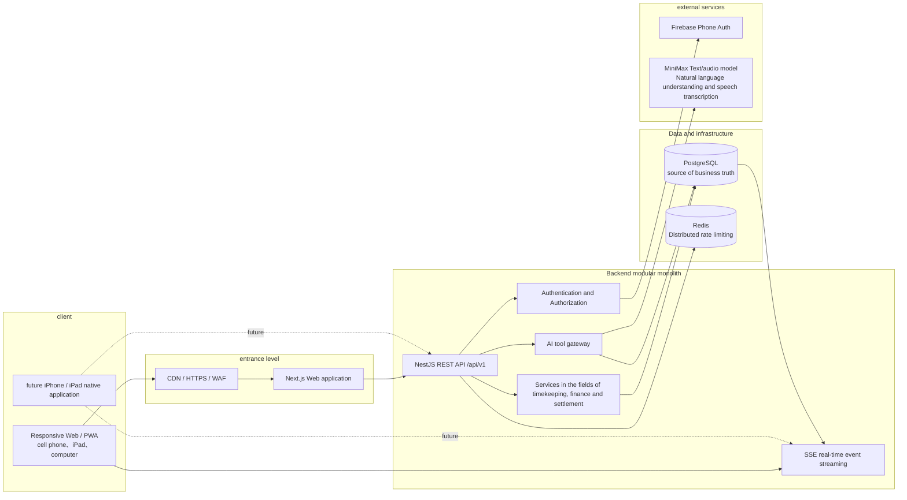
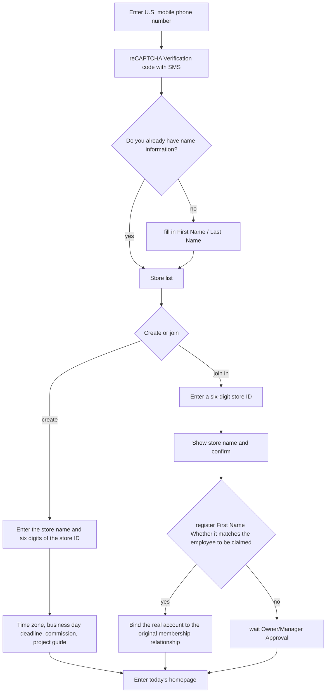
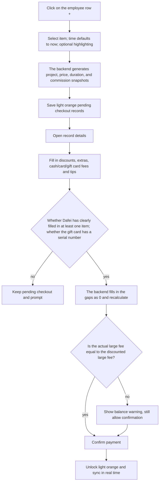
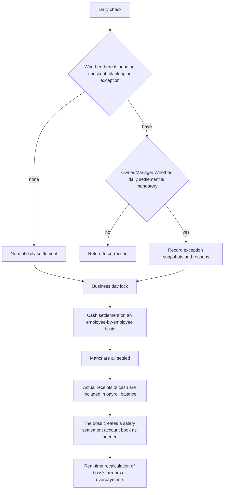
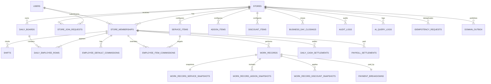

<a id="按摩店记工与财务管理系统架构与实施计划"></a>

# Massage shop work record and financial management system: structure and implementation plan

**English** | **[简体中文](INITIAL_ARCHITECTURE_PLAN.zh-CN.md)**

> Historical references, not current rules. Reason: Save evidence of current design, review or delivery for traceability; all old requirements no longer bind the current code.

> **Archived Document**: This is the initial design and phased plan confirmed before coding on 2026-08-04. Routing, modules and testing tools have changed, please do not use this to judge the current implementation. See [`../engineering/ARCHITECTURE.md`](../engineering/ARCHITECTURE.md) for the current architecture, and see [`../product/PRODUCT.md`](../product/PRODUCT.md) for the current product rules. Original status: confirmed, implemented on 2026-08-04; original basis: product requirements and confirmed supplementary rules.
> Product interface: The first version is all in Simplified Chinese; code, database fields and API paths use English internal naming

<a id="0-已确认的设计结论"></a>

## 0. Confirmed design conclusions

1. Permission roles are separated from "whether to participate in work record". Owner, Manager, and Employee can all participate in work record.
2. Managers who participate in work records enter ordinary salary settlement; the owner himself calculates service income, but does not generate "the boss owes himself".
3. Discounts do not reduce employee wages.
4. The amount is non-negative, and the discount does not exceed the service fee base; an independent correction process will be used after the refund.
5. When there is insufficient cash, only the cash actually received by employees will be counted as "obtained through cash", and the shortfall will still be paid by the boss.
6. Employees cannot modify it after the daily closing; the owner or manager must cancel the daily closing first. The relevant cash settlement automatically returns to unsettled.
7. Customized items use the employee's default commission, followed by the store's global commission; employees cannot modify the commission for this order by themselves.
8. Payment confirmation supports cash, credit card and gift card; gift card payment must carry the serial number, and all blank amounts will automatically be converted to 0, but the service fee must clearly fill in at least one payment method.
9. All amounts are reported to whole cents; wages are calculated individually for all service items and rounded to the nearest cent.
10. The first version does not allow offline writing. When the network is disconnected, the unsubmitted form is retained and clearly prompted, and the user resubmits it after the network is restored.

---

<a id="1-系统架构"></a>

## 1. System architecture

<a id="11-总体架构图"></a>

### 1.1 Overall architecture diagram



<a id="12-技术选型"></a>

### 1.2 Technology selection

| Level | Selection | Reason |
|---|---|---|
| Monorepo | pnpm workspaces | Unify TypeScript, contracts, tests, and scripts using a controlled runtime environment that comes with the workspace |
| Web | Next.js App Router + TypeScript | Responsive pages, PWA, server-side first screen and future multi-language structures; using the officially recommended App Router |
| UI | React + Accessible Component Basics + CSS Design Token | Supports large fonts, large buttons, high contrast and mobile adaptation, and does not rely on icon expression |
| API | NestJS modular monolith | Clear structure of permissions, authentication, transactions and SSE; future native applications can directly reuse REST API |
| Database | PostgreSQL | Transactions, constraints, partially unique indexes, JSONB auditing and row-level security capabilities are suitable for financial systems |
| ORM | Prisma | Type safety, migration, transactions and optimistic locking are implemented clearly; complex constraints are supplemented by SQL migration |
| Verification | Zod (shared API contract) + back-end DTO pipeline | The front-end and back-end share the input structure; the back-end is still the final validator |
| Real-time | NestJS SSE + PostgreSQL Outbox | The client only needs to receive the "changed" notification, SSE is lighter; event persistence supports disconnected cursors, multiple instances jointly read the same PostgreSQL, and resynchronize through REST after disconnection |
| Login | Firebase Phone Auth + backend secure session cookies | Meets US phone number verification codes, reCAPTCHA, multiple devices and revoke all sessions |
| AI | Self-built `LanguageModelProvider`, the first to implement MiniMax | AI is isolated from business tools and can replace suppliers; MiniMax’s current text interface supports tool calling |
| Speech | Self-built `SpeechToTextProvider`, the first to implement MiniMax `music-cover` built-in ASR | Shared API key with text model, Provider boundary remains replaceable, supports Chinese and English short audio |
| Testing | Vitest + Supertest + Playwright | Hierarchical coverage of domain formulas, API permissions and end-to-end operations |
| Deployment | Containerized Web, API + managed PostgreSQL/Redis | Not bound to a single cloud platform, Web and API can be expanded independently; first version maintenance tasks are performed by controlled scheduled tasks |

Version strategy: Select and lock the stable version of the day at the beginning of coding, and do not use floating `latest`; each upgrade must go through financial, permission and migration testing.

<a id="13-模块边界"></a>

### 1.3 Module boundaries

```text
apps/
  web/          Chinese responsive Web/PWA
  api/          REST API、SSE、Certification、AI and domain orchestration
packages/
  contracts/    Zod request/response, events and AI instrumental contract
  domain/       Amount, salary, business day, and permission rules without framework dependencies
  ui/           Age-friendly components and design tokens
  config/       TypeScript、Lint、Test shared configuration
```

The backend remains a "modular monolith" and the first version does not dismantle microservices. The core modules are: Auth, Stores, Memberships, Catalog, Shifts, WorkRecords, Finance, BusinessDayClosing, CashSettlement, Payroll, Audit, Realtime, AI.

<a id="14-真相来源原则"></a>

### 1.4 Principle of source of truth

- PostgreSQL is the single source of truth for your business data.
- SSE events only notify "data has changed" and are not final data.
- The front-end does not submit wages, totals, or final values owed by the boss; the back-end recalculates from details.
- Saved summary snapshots are used for historical queries and auditing, but must be generated by a domain calculator.
- AI outputs are only candidate parameters and cannot be a source of financial truth.

---

<a id="2-页面与路由清单"></a>

## 2. Page and route list

All visible titles, buttons, status, errors, dates and amount descriptions are in Chinese. Use a stable English path for the URL to avoid link changes caused by future translation.

| Routing | Pages | Main Roles | Mobile Focus |
|---|---|---|---|
| `/login` | Mobile phone number login, verification code | All | Numeric keyboard, resend countdown, clear error |
| `/onboarding/profile` | Fill in the name for the first time | All | Two large input boxes |
| `/stores` | My store, switch store | All | Large card list |
| `/stores/new` | Create store | All | Six-digit ID and duplicate check |
| `/stores/join` | Apply to join a store | All | Display the store name first and then confirm |
| `/s/[storeId]/setup` | Store setup wizard | Owner | Step-by-step form, returnable |
| `/s/[storeId]/today` | Today's work record main page | Valid members | Mobile employee cards; Horizontal paper forms |
| `/s/[storeId]/day/[businessDate]` | Specify business day main table | Owner/Manager | Historical status, daily closing lock prompt |
| `/s/[storeId]/records/[recordId]` | work record details | By permissions | Fixed save button, delete away from save |
| `/s/[storeId]/finance` | Whole store finance | Owner/Manager | Filter drawer, expandable details |
| `/s/[storeId]/my-finance` | My finances | Participating work record members | Due, obtained, paid, owed |
| `/s/[storeId]/cash/[businessDate]` | Daily cash settlement | Owner/Manager; employees can only read themselves | One person, one card, one-click settlement |
| `/s/[storeId]/payroll` | Salary settlement ledger | Owner/Manager | Add payment, history, revocation |
| `/s/[storeId]/payroll/[settlementId]` | Salary settlement details | Owner/Manager; employees can only read their own | Display calculation composition |
| `/s/[storeId]/close/[businessDate]` | daily closing check and daily closing | Owner/Manager | Exception pinned, forced daily closing secondary confirmation |
| `/s/[storeId]/members` | Members, applications, roles, participation work record | Owner/Manager | Prevention of accidental deletion, role description |
| `/s/[storeId]/catalog/services` | Main projects | Owner/Manager | Sorting, start and stop, price and commission |
| `/s/[storeId]/catalog/addons` | Additional items | Owner/Manager | Same as above |
| `/s/[storeId]/catalog/discounts` | Discount items | Owner/Manager | Fixed amount |
| `/s/[storeId]/commissions` | Employee default and special commissions | Owner/Manager | Display effective priority |
| `/s/[storeId]/settings` | Store settings | Owner/Manager | Time zone, deadline, store name |
| `/s/[storeId]/audit` | Operation log | Owner/Manager | Filter by date, person, object |
| `/s/[storeId]/ai/work` | AI work record assistant | Valid members | Text, recording, structured preview |
| `/s/[storeId]/ai/finance` | AI financial assistant | By financial authority | Answers must include statistical scope and detailed entry |

Global navigation: Today, My Finance, AI; Owner/Manager additionally displays Finance, Settlement, and Management. There are up to four main entrances in the bottom navigation of the phone, and the rest are placed in "More".

---

<a id="3-用户流程"></a>

## 3. User flow

<a id="31-注册创建或加入店铺"></a>

### 3.1 Register, create or join a store



<a id="32-快速记工与付款确认"></a>

### 3.2 Fast work record and payment confirmation



<a id="33-日结现金结算与工资结算"></a>

### 3.3 daily closing, cash settlement and salary settlement



History correction: first cancel the daily closing → return the relevant cash settlement to unsettled → modify the work record → re-do the daily closing → re-confirm the cash; the existing salary settlement account book is retained, the balance is automatically recalculated and a historical modification warning is displayed.

---

<a id="4-角色权限矩阵"></a>

## 4. Role permission matrix

`参与记工`It is a member attribute, not the fourth role. "Self" in the table below refers to data generated by the member as a service worker.

| Capabilities | Owner | Manager | Employee |
|---|---:|---:|---:|
| View the work record of all employees on the day | Yes | Yes | Yes |
| Add/modify/delete the work record of all employees on the day | Yes | Yes | Yes |
| Modify closed or historical work record | After canceling daily closing | After canceling daily closing | No |
| View all your financial history | Yes | Yes | Yes |
| View other people's financial history | Yes | Yes | No |
| Punch in and out | When participating in work record | When participating in work record | When participating in work record |
| Using work record AI | Yes | Yes | Yes |
| Using financial AI | Storewide | Storewide | Only yourself |
| Manage projects, discounts and commissions | Yes | Yes | No |
| Approval of joining application | Yes | Yes | No |
| Fill in name only to pre-create employees | Yes | Yes | No |
| Modify regular member/manager role | Yes | Yes | No |
| Modify, remove or demote Owner | Through transfer process only | No | No |
| Specify another Manager | Yes | Yes | No |
| daily closing, cancel daily closing | Yes | Yes | No |
| Cash Settlement | Yes | Yes | See only myself |
| Salary Settlement | Yes | Yes | View only yourself |
| View full store audit | Yes | Yes | No |
| Modify store settings | Yes | Yes | No |
| Transfer Owner | Yes | No | No |
| Delete store | Yes | No | No |

Additional restrictions:

- When an employee modifies someone else's record of the day, the audit log clearly records the operator and the employee involved.
- Employees cannot modify any commission ratio, even if the record belongs to them.
- The Owner's service income is included in the business statistics, but is excluded from salary settlement objects and "the boss still owes employees".
- All permissions are jointly enforced by API Guard, domain permission policies, and database tenant isolation. Front-end hidden buttons do not constitute permission control.

---

<a id="5-er-图"></a>

## 5. ER diagram

To keep the diagram readable, only major relationships are shown; detailed snapshots, events, and audit fields are provided in the next section.



---

<a id="6-数据表与字段设计"></a>

## 6. Data table and field design

<a id="61-通用约定"></a>

### 6.1 General Conventions

- The primary key uses an application-generated UUID; the six-digit store ID uses `char(6)`, leading 0s are allowed.
- Use `timestamptz` for time points; use store local `date` for business day.
- The amount field has a unified suffix of `_cents`, type `bigint`, and normal business input `>= 0`.
- The commission has a unified suffix of `_bps`, `60% = 6000`, and a range of `0..10000`.
- Modifiable aggregate root with `version integer`, starting from 1.
- The soft deletion object takes `deleted_at`, `deleted_by`, `delete_reason`.
- Business table with `created_at`, `updated_at`, `created_by`, `updated_by`.
- The tenant business table must have `store_id`, and create an index starting with `store_id`.

<a id="62-账号店铺和成员"></a>

### 6.2 Accounts, stores and members

| Table | Key Fields | Constraints and Description |
|---|---|---|
| `users` | `firebase_uid`, `phone_e164`, `first_name`, `last_name`, `status` | `firebase_uid`, unique phone number; phone number encrypted/controlled display |
| `stores` | `store_code`, `name`, `timezone`, `business_cutoff_local`, `owner_membership_id`, `status`, `version` | `store_code` Globally unique; timezone is IANA name; deletion is soft deletion |
| `store_memberships` | `store_id`, `user_id`, `role`, `display_name`, `is_service_provider`, `default_commission_bps`, `status`, `joined_at`, `left_at`, `version` | `user_id` can be empty before claiming by pre-created employees; active display name is case-insensitive and unique; only one active per store Owner |
| `store_join_requests` | `store_id`, `user_id`, `requested_display_name`, `status`, `reviewed_by`, `reviewed_at`, `version` | The same user and store are only allowed one pending application |

Owner transfer locks the store and two memberships in a `Serializable` transaction, while updating the old/new roles and `owner_membership_id`. If any step fails, the entire process will be rolled back.

<a id="63-营业日排班和表格"></a>

### 6.3 business day, schedule and form

| Table | Key Fields | Constraints and Description |
|---|---|---|
| `shifts` | `store_id`, `membership_id`, `business_date`, `clock_in_at`, `clock_out_at`, `created_by` | Allow multiple segments in a day; the same member can have at most one off-duty record |
| `daily_boards` | `store_id`, `business_date`, `version` | Unique per store per business day; concurrent token sorted throughout the day |
| `daily_employee_rows` | `board_id`, `store_id`, `membership_id`, `position`, `is_hidden`, `added_by`, `version` | One row per person per day; hiding does not affect records and finances |

 business day calculation: put `start_at` Convert to store time zone; if local time `>= business_cutoff_local`, `business_date = 本地日期 + 1 天`, otherwise the local date. Exactly the deadline falls on the next business day. Records are saved simultaneously `store_timezone_snapshot` and `business_cutoff_snapshot`; Modifying store settings in the future will not re-distribute old records.

<a id="64-项目与提成"></a>

### 6.4 Projects and commissions

| Table | Key Fields | Constraints and Description |
|---|---|---|
| `service_items` | `store_id`, `full_name`, `short_name`, `default_commission_bps`, `position`, `is_enabled` | Project identity and commission; old duration/price columns are only compatible with rolling deployment |
| `service_item_price_options` | `service_item_id`, `duration_minutes`, `price_cents`, `position` | The duration of the same item is unique; duration 1–720 minutes; price is non-negative |
| `addon_items` | `store_id`, `name`, `short_name`, `amount_cents`, `duration_minutes`, `default_commission_bps`, `position`, `is_enabled` | Duration can be null |
| `discount_items` | `store_id`, `name`, `short_name`, `amount_cents`, `position`, `is_enabled` | Only supports fixed amounts |
| `employee_default_commissions` | `store_id`, `membership_id`, `commission_bps`, `effective_from`, `effective_to` | Keep the history of the time period and do not overwrite old values |
| `employee_item_commissions` | `store_id`, `membership_id`, `item_type`, `item_id`, `commission_bps`, `effective_from`, `effective_to` | Project-level special ratio; time periods must not overlap |

`store_memberships.default_commission_bps` can be cached as the current value, and the historical and effective intervals are based on the commission table. The actual work record keeps a final scale snapshot forever.

<a id="65-记工与快照"></a>

### 6.5 work record and snapshot

| Table | Key Fields | Constraints and Description |
|---|---|---|
| `work_records` | `store_id`, `employee_membership_id`, `business_date`, `start_at`, `end_at`, `actual_duration_minutes`, `status`, `is_highlighted`, `note`, each summary amount, `version` | `status = pending_payment / confirmed`; highlight only changes the display and query filtering; soft deletion ;Summaries are only written by the server |
| `work_record_service_snapshots` | `work_record_id`, `source_service_item_id`, `is_custom`, `name`, `short_name`, `amount_cents`, `duration_minutes`, `commission_bps`, `wage_cents` | One by one; update the current snapshot when changing the project, while retaining the old value in the audit |
| `work_record_addon_snapshots` | `work_record_id`, `source_addon_item_id`, `is_custom`, `name`, `short_name`, `amount_cents`, `duration_minutes`, `commission_bps`, `wage_cents`, `position` | One single and multiple |
| `work_record_discount_snapshots` | `work_record_id`, `source_discount_item_id`, `is_custom`, `name`, `amount_cents`, `position` | One order and multiple; the total amount shall not exceed the service fee base |
| `payment_breakdowns` | `work_record_id`, `cash_service_cents`, `card_service_cents`, `gift_card_serial_number`, `gift_card_service_cents`, `cash_tip_cents`, `card_tip_cents`, `gift_card_tip_cents`, `confirmed_at`, `confirmed_by`, `version` | Can be empty when checking out; after confirmation, the six amounts are not empty or negative; when using gift card, the serial number is not empty |
| `gift_card_sales` | `store_id`, `business_date`, `serial_number`, `serial_number_normalized`, `face_value_cents`, `discount_threshold_cents`, `discount_rate_bps`, `discount_cents`, `cash_cents`, `card_cents`, `amount_cents`, `operator_membership_id`, `version` | The face value minus discount is equal to cash plus card and is greater than 0; the serial number of each store is allocated from transaction 1001 and is not reused; soft deletion and audit |

Server summary fields for `work_records`:

- `main_service_amount_cents`
- `addon_total_cents`
- `gross_fee_base_cents`
- `discount_total_cents`
- `discounted_fee_performance_cents`
- `cash_service_cents`
- `card_service_cents`
- `gift_card_serial_number` (empty when gift card is not used)
- `gift_card_service_cents`
- `cash_tip_cents` (can be empty pending checkout)
- `card_tip_cents` (can be empty pending checkout)
- `gift_card_tip_cents` (can be empty pending checkout)
- `total_tip_cents` (can be empty pending checkout)
- `actual_service_collected_cents`
- `customer_total_paid_cents` (can be empty pending checkout)
- `main_service_wage_cents`
- `addon_wage_cents`
- `total_large_fee_wage_cents`
- `employee_total_income_cents` (tips are temporary values when unknown and marked with incomplete)
- `cash_allocated_service_wage_cents`
- `cash_acquired_service_wage_cents`
- `cash_wage_shortfall_cents`

The service commission of pending checkout records is still included in "today's temporary statistics", but blank tips cannot be silently disguised as confirmed 0; the API also returns `incomplete_record_count`. Normal daily closing requires completion, and forced daily closing is allowed to continue with abnormal snapshots.

<a id="66-日结现金和工资账本"></a>

### 6.6 daily closing, cash and payroll ledger

| Table | Key Fields | Constraints and Description |
|---|---|---|
| `business_day_closings` | `store_id`, `business_date`, `cycle_no`, `status`, `is_forced`, `warning_snapshot_json`, `totals_snapshot_json`, `closed_by`, `closed_at`, `cancelled_by`, `cancelled_at`, `version` | Refresh every time daily closing creates a new cycle; there is at most one valid closing cycle for the same business day |
| `daily_cash_settlements` | `store_id`, `business_date`, `membership_id`, the amount of each cash snapshot, `status`, `note`, `settled_by`, `settled_at`, `version` | One current record per person per day; save the calculation snapshot when settling; return to unsettled after modifying the history |
| `payroll_settlements` | `store_id`, `membership_id`, `settlement_date`, `period_start`, `period_end`, `service_wage_cents`, `cash_tip_cents`, `card_tip_cents`, `adjustment_cents`, `total_paid_cents`, `payment_method`, `note`, `version` | Owner cannot be the object to be paid; the total amount is calculated by the server; soft deletion |

The date range and highlight status are account description and filtering dimensions and do not lock or "occupy" a certain batch of work records; date ranges are allowed to overlap. The highlight filter must work on both financial summaries, component details, and CSV exports. Owner's outstanding is always recalculated on a cumulative basis, earned through settled cash, and valid payroll ledger, so partial payments, overpayments, and historical revisions do not create double vesting logic.

<a id="67-审计可靠性和-ai"></a>

### 6.7 Auditing, Reliability and AI

| Table | Key Fields | Constraints and Description |
|---|---|---|
| `audit_logs` | `store_id`, `actor_user_id`, `actor_membership_id`, `action`, `entity_type`, `entity_id`, `business_date`, `before_json`, `after_json`, `reason`, `request_id`, `created_at` | Append only, no update, no soft deletion ;Same transaction as business writing |
| `idempotency_requests` | `store_id`, `user_id`, `key`, `route`, `request_hash`, `status`, `response_code`, `response_json`, `expires_at` | `(store_id,user_id,key,route)` unique; the same key and different request bodies return conflicts |
| `domain_outbox` | `store_id`, `topic`, `aggregate_type`, `aggregate_id`, `payload_json`, `created_at`, `published_at`, `attempt_count` | Written in the same transaction as business audit; SSE delivers at least once according to the cursor, and the client re-pulls the REST truth after receiving it |
| `ai_conversations` | `store_id`, `user_id`, `assistant_type`, `created_at`, `last_message_at` | Conversation isolation by store |
| `ai_query_logs` | `conversation_id`, `store_id`, `user_id`, `model_provider`, `model_name`, `input_text`, `tool_calls_json`, `tool_results_redacted_json`, `outcome`, `latency_ms`, `created_at` | Audio is not saved; sensitive fields are masked; configurable retention period |
| `ai_change_previews` | `store_id`, `user_id`, `operation`, `canonical_payload_json`, `base_versions_json`, `warnings_json`, `expires_at`, `confirmed_at`, `consumed_at` | One-time preview; re-authenticate, recalculate and check version when confirming |

<a id="68-关键数据库约束"></a>

### 6.8 Key database constraints

- Active Owner: Each `store_id` only one `role='OWNER'` active membership.
- Active display name: `(store_id, lower(display_name))` Partially unique.
- Store code: six-digit regular check and globally unique.
- All snapshot amounts are non-negative; the total discount does not exceed the service fee base through domain transaction verification.
- Commission `0..10000 bps`.
- `end_at >= start_at`; allows cross-business day deadlines, but the business date does not change.
- The six split amounts of the confirmed payment are all non-empty; when the gift card amount is greater than 0, the serial number must be non-empty, and when the amount is 0, the serial number must be empty.
- All store-scoped foreign keys try to use `(store_id, id)` combination constraints to prevent incorrect cross-store associations.

---

<a id="7-财务公式舍入与边界案例"></a>

## 7. Financial formulas, rounding and edge cases

<a id="71-基础金额"></a>

### 7.1 Basic amount

set up:

- `P`: Main item amount
- `Ei`: the amount of the i-th additional item, `E = ΣEi`
- `D`: total discount
- `CS`: cash service fee
- `CC`: Swipe card service fee
- `GCS`: gift card service fee
- `CT`: cash tips
- `CCT`: tips for swiping your card
- `GCT`: gift card tips

```text
Big fee base = P + E
Great results after discounts = P + E - D
Actual service fee = CS + CC + GCS
Collection difference = Actual service fee - Great results after discounts
Total tip = CT + CCT + GCT
Total guest payment = CS + CC + GCS + CT + CCT + GCT
```

Interface suggested tags:`大费总额 (折扣前)`, `折后大费`, `实际收到大费`, `收款差额`, to avoid misunderstanding "actual service fees" as software service fees.

<a id="72-提成与工资"></a>

### 7.2 Commission and wages

```text
Main project salary = round_half_up(P × main_rate_bps / 10000)
Single additional project salary_i = round_half_up(Ei × addon_rate_i_bps / 10000)
Extra project salary = ΣSingle additional project salary_i
Big salary W = Main project salary + Extra project salary
Total income due to employees = W + CT + CCT + GCT
```

Items must be rounded off item by item before adding, items cannot be combined and then multiplied by a ratio. Discounts do not enter into the salary formula.

<a id="73-混合付款现金分摊"></a>

### 7.3 Mixed payment cash allocation

Each record is calculated independently:

```text
like CS + CC + GCS > 0：
  Cash corresponds to large wages A = round_half_up(W × CS / (CS + CC + GCS))
otherwise：
  A = 0，and produce“The actual service fee charged is 0”abnormal

Big salary actually received in cash AC = min(CS, A)
Insufficient cash salary S = A - AC
```

In order to ensure accurate addition after amortization, the non-cash side (swipe card and gift card) uses `W - A` for the corresponding salary, and does not divide and round separately again.

Each employee per day:

```text
Employees received a total of cash = ΣCS + ΣCT
actually obtained in cash = ΣAC + ΣCT
Employees should submit store cash = ΣCS - ΣAC
Insufficient cash salary = ΣS
```

The amount due will not be negative. Only after the employee's cash settlement for the day is marked as "all settled", `ΣAC + ΣCT` will enter the cumulative "acquired through cash".

<a id="74-老板尚欠与超额支付"></a>

### 7.4 The boss’s arrears and overpayments

Excluding Owner’s own records:

```text
original balance B = Accumulated total income due to employees
             - Actual acquisition through cleared cash settlement
             - Accumulation of effective salary settlement ledgers total_paid

The boss still owes = max(B, 0)
Overpaid = max(-B, 0)
```

payroll ledger:

```text
total_paid = service_wage + cash_tip + card_tip + adjustment
```

The first three terms are non-negative, and `adjustment` can be positive or negative. If the final total is negative, an additional confirmation must be made and the reason must be filled in; this ledger is equivalent to offsetting the existing payment, but does not modify the historical work record.

<a id="75-完整示例"></a>

### 7.5 Complete example

Main items are $100, commission is 60%; additional items are $20, commission is 50%; discount is $15; cash service fee is $40, card service fee is $65; cash tips are $10, card tips are $20:

| Project | Results |
|---|---:|
| service fee base | $120.00 |
| Service fee performance after discount | $105.00 |
| Actual service fee | $105.00 |
| Major Project Salary | $60.00 |
| Additional Project Pay | $10.00 |
| service commission | $70.00 |
| Total employee earnings | $100.00 |
| Cash service commission | $26.67 |
| Actually obtained in cash | $26.67 + $10.00 = $36.67 |
| Store cash should be submitted | $40.00 - $26.67 = $13.33 |
| The boss still owes before salary settlement | $100.00 - $36.67 = $63.33 |

<a id="76-必测边界"></a>

### 7.6 Required boundaries

1. All cash, all card swiping, no tips, enter 0 explicitly.
2. service fee means swiping a card and tips means cash; service fee means cash and tips means swiping a card.
3. Service fee cash/card hybrid, resulting in half-cent rounding.
4. Multiple additional projects use different commissions.
5. Multiple discounts, the discount is exactly equal to the service fee base.
6. $0 after discount, but the employee still has wages; the cash-strapped wage gap goes into what the boss still owes.
7. The actual charge is less than, equal to and more than the discounted service fee.
8. The actual service fee charged is 0.
9. There are four levels of commission priority and two levels of custom projects.
10. After modifying the template and commission, the historical salary remains unchanged.
11. Cancel, modify, and restart daily closing after daily closing, and the cash status will be rolled back.
12. Partial salary payments, overpayments, negative adjustments, deletions and reinstatements.
13. The Owner participates in the work record but does not generate a balance due to the boss; the Manager participates in the work record and generates a balance.
14. tips The difference between blank and clear 0.

---

<a id="8-api-设计"></a>

## 8. API design

<a id="81-通用规范"></a>

### 8.1 General specifications

- Prefix: `/api/v1`.
- The JSON amount is uniformly transmitted as an integer cent; the API response can additionally provide `formatted` Chinese display value.
- All resources respond with `id`, `version`, `updatedAt`.
- POST/PATCH/DELETE must have the `Idempotency-Key`; updates and deletes must have the expected `version`.
- The store is obtained from the path, and the backend verifies membership; the `storeId` in the request body is not trusted.
- Error structure: `code`, `messageZh`, `fieldErrors`, `requestId`, optional `latestResource`.
- Cursors are used for paging; stable sorting is used for financial export and detailed queries.

<a id="82-认证和账号"></a>

### 8.2 Authentication and account

| Method | Path | Description |
|---|---|---|
| POST | `/auth/session` | Use Firebase ID token to replace backend HttpOnly session |
| DELETE | `/auth/session` | Exit the current device |
| DELETE | `/auth/sessions` | Revoke Firebase refresh tokens and log out of all devices |
| GET | `/me` | Current user, store membership summary |
| PATCH | `/me/profile` | First or subsequent name change |

<a id="83-店铺与成员"></a>

### 8.3 Stores and Members

| Method | Path | Description |
|---|---|---|
| POST | `/stores` | Create store and Owner membership |
| GET | `/stores/resolve-code/:code` | Returns the store name that can be disclosed without revealing member information |
| GET/PATCH/DELETE | `/stores/:storeId` | Read, modify, soft deletion stores |
| POST | `/stores/:storeId/owner-transfer` | Atomic transfer Owner |
| POST | `/stores/:storeId/join-requests` | Apply to join |
| GET | `/stores/:storeId/join-requests` | Owner/Manager View pending approval |
| POST | `/stores/:storeId/join-requests/:id/approve` | Approval |
| POST | `/stores/:storeId/join-requests/:id/reject` | REJECT |
| GET/PATCH/DELETE | `/stores/:storeId/members/:membershipId` | Members, roles, participation work record, resignation |
| POST | `/stores/:storeId/members` | Owner/Manager Fill in only the name to create an employee to be claimed |
| POST | `/stores/:storeId/members/:membershipId/restore` | Restore membership |

<a id="84-排班今日表格和记工"></a>

### 8.4 Shift scheduling, today’s form and work record

| Method | Path | Description |
|---|---|---|
| GET | `/stores/:storeId/business-days/current` | Returns the current business day as determined by the server |
| GET | `/stores/:storeId/boards/:businessDate` | Snapshot of tables, records and statistics throughout the day |
| POST | `/stores/:storeId/shifts/clock-in` | Go to work and make sure today's row exists |
| POST | `/stores/:storeId/shifts/:shiftId/clock-out` | After get off work |
| POST | `/stores/:storeId/boards/:date/rows` | Owner/Manager Add people manually |
| PATCH | `/stores/:storeId/boards/:date/rows/:rowId` | Hide/show; allowed to be executed after daily closing without changing the business amount or daily closing status |
| POST | `/stores/:storeId/boards/:date/reorder` | Atomic sort by board version |
| POST | `/stores/:storeId/work-records` | Quickly create pending checkout records |
| GET | `/stores/:storeId/work-records/:recordId` | Details and audit summary |
| PATCH | `/stores/:storeId/work-records/:recordId` | Modify items, time, amount, etc. |
| POST | `/stores/:storeId/work-records/:recordId/confirm-payment` | Add 0, recalculate and confirm payment |
| DELETE | `/stores/:storeId/work-records/:recordId` | soft deletion |
| POST | `/stores/:storeId/work-records/:recordId/restore` | Owner/Manager restore |
| GET | `/stores/:storeId/gift-card-sales` | Owner/Manager View the gift card ledger sorted by serial number and with multiple usage records |
| POST | `/stores/:storeId/gift-card-sales` | Record the gift cards sold on the day, automatically assign serial numbers and verify actual receipts based on face value and discount snapshot |
| PATCH/DELETE | `/stores/:storeId/gift-card-sales/:saleId` | Modify or soft deletion card sales records; use optimistic locking and auditing |
| GET/POST | `/stores/:storeId/gift-card-sales/deleted`, `.../:saleId/restore` | Owner/Manager View and restore card sales records |

<a id="85-财务日结和结算"></a>

### 8.5 Finance, daily closing and settlement

| Method | Path | Description |
|---|---|---|
| GET | `/stores/:storeId/finance/summary` | Summary by date, person, payment method, amount type |
| GET | `/stores/:storeId/finance/details` | Composition details |
| GET | `/stores/:storeId/finance/my-balance` | The current user’s own cumulative balance |
| GET | `/stores/:storeId/closings/:date/preview` | daily closing checks and exceptions |
| POST | `/stores/:storeId/closings/:date` | Normal or forced daily closing |
| POST | `/stores/:storeId/closings/:date/cancel` | Cancel daily closing and fall back to cash status |
| GET | `/stores/:storeId/cash-settlements/:date` | Daily cash calculation |
| POST | `/stores/:storeId/cash-settlements/:date/:membershipId/settle` | Mark all settled |
| POST | `/stores/:storeId/cash-settlements/:date/:membershipId/reopen` | Cancel settlement |
| POST | `/stores/:storeId/cash-settlements/:date/settle-all` | One-click settlement |
| GET/POST | `/stores/:storeId/payroll-settlements` | List, new ledger |
| GET/PATCH/DELETE | `/stores/:storeId/payroll-settlements/:id` | View, modify, soft deletion |
| POST | `/stores/:storeId/payroll-settlements/:id/restore` | Restore |

<a id="86-设置审计和-ai"></a>

### 8.6 Setup, Auditing and AI

Items, extras, discounts and commissions respectively use the standard `/stores/:storeId/...` CRUD API; deletions are all soft deletion. Audit using `GET /stores/:storeId/audit-logs`.

| Method | Path | Description |
|---|---|---|
| POST | `/stores/:storeId/ai/work/messages` | To send text, the model can only call the work record tool |
| POST | `/stores/:storeId/ai/work/transcribe` | Upload short audio and return text, not executed directly |
| POST | `/stores/:storeId/ai/finance/messages` | Financial Q&A, read-only tool |
| GET | `/stores/:storeId/ai/previews/:previewId` | Get structured preview |
| POST | `/stores/:storeId/ai/previews/:previewId/confirm` | Executed once after user confirms |
| DELETE | `/stores/:storeId/ai/previews/:previewId` | Discard preview |

---

<a id="9-实时同步与并发冲突"></a>

## 9. Real-time synchronization and concurrency conflicts

<a id="91-事件流"></a>

### 9.1 Event flow

1. API updates business data, audit logs, and `domain_outbox` in database transactions.
2. Respond to the client immediately after successful submission.
3. Authenticated SSE connections read events from the outbox sequentially by `storeId` and `lastEventId`; send a heartbeat when there are no events.
4. After receiving `store.changed`, the client debounces and re-obtains the REST truth of the current page.
5. The outbox is retained for 7 days for short-term reconnection; when the cursor expires, the initial page load itself rereads the full snapshot.

Main events: `work_record.created/updated/deleted/restored`, `board.reordered`, `shift.changed`, `closing.changed`, `cash_settlement.changed`, `payroll.changed`, `catalog.changed`, `membership.changed`.

The event only contains `eventId`, `storeId`, `businessDate`, `resourceType`, `resourceId`, `version`, `occurredAt` and does not broadcast the complete sensitive financial data.

<a id="92-乐观锁"></a>

### 9.2 Optimistic locking

- PATCH/DELETE using `WHERE id = ? AND store_id = ? AND version = expectedVersion`.
- 0 row updates return HTTP 409 with the latest resource.
- Financial fields such as work record amount, employee attribution, and payment split are not automatically merged; users can try again after checking the differences.
- Note also uses the overall version to avoid silent overwriting.
- Drag sort uses `daily_boards.version` as the whole board token and updates all positions in a single transaction.

<a id="93-幂等与重复点击"></a>

### 9.3 idempotency and repeated clicks

- The client generates a unique `Idempotency-Key` for each user operation, and the network retries the same key.
- The same key, path and request body will return the first result and will not be written again.
- The same key but different request body returns 409 `IDEMPOTENCY_KEY_REUSED`.
- AI preview confirmation also carries a one-time `previewId`, which cannot be executed again after consumption.

<a id="94-断网和重新连接"></a>

### 9.4 Disconnect and reconnect

- The first version does not support offline addition, modification or deletion to avoid offline accounting conflicts between multiple devices.
- The edited work record details are kept on the local machine for up to 7 days under the protection of the record version; submission is disabled when the network is disconnected and "network disconnection, content has not been saved" is displayed. Logging out will clear this app draft.
- When a request times out but the result is unknown, the client queries/retries with the same idempotency key.
- EventSource automatically submits `Last-Event-ID` when reconnected; the latest snapshot is obtained through REST after the first entry of the page and event notification.
- PWA only caches the application shell and static resources, and does not cache sensitive financial responses to the shared browser cache for a long time.

---

<a id="10-审计日志方案"></a>

## 10. Audit log solution

<a id="101-写入范围"></a>

### 10.1 Writing range

Work record addition/modification/deletion/restoration, note modification, payment confirmation, punch-in, sorting, hiding, daily closing/cancellation, cash settlement/return, payroll ledger, role, participating work record status, commission, project, store settings, Owner transfer, AI confirmation writing are all audited.

<a id="102-原则"></a>

### 10.2 Principles

- Auditing and business writing are located in the same database transaction.
- `before_json` and `after_json` use stable field names and store dollar cent values.
- Each log records actor, target employee, store, business day, request ID, idempotency key summary, and operation source `web/api/ai/system`.
- Automatic state fallback uses `actor = system` and records the parent `request_id` that triggered the fallback.
- The audit table only appends, and the application account does not have UPDATE/DELETE permissions.
- Mobile phone numbers, Firebase tokens, cookies, MiniMax keys, and complete audio must not be written into the audit.

<a id="103-查看权限"></a>

### 10.3 View permissions

- Owner/Manager can view the complete audit of our store.
- Employee can see a simplified modification history in the record details that he has permission to view; the historical date only shows his own record history.
- Cross-store audit queries are rejected by the service layer to enforce store scope, object ownership verification and non-superuser database accounts, and have real PostgreSQL integration tests.

---

<a id="11-ai-工具调用协议"></a>

## 11. AI tool calling protocol

<a id="111-分层"></a>

### 11.1 Layering


<a id="112-允许工具"></a>

### 11.2 Allowed tools

| Tools | Types | Permissions and Usage |
|---|---|---|
| `get_today_work_records` | Read | All valid members see the current day; return controlled fields |
| `get_work_record_candidates` | Read | Find records to be modified based on name, time, and project |
| `prepare_create_work_record` | Preview | Generate new draft without writing business table |
| `prepare_update_today_work_record` | Preview | Only today's records that the caller has permission to modify can be modified |
| `prepare_delete_today_work_record` | Preview | Deletion preview must contain the complete record and secondary confirmation copy |
| `calculate_employee_finance` | Read | Employee can only be yourself; Owner/Manager is the designated member of this store |
| `calculate_store_finance` | Read | Owner/Manager Shop |
| `get_daily_cash_settlement` | Read | Employee can only control himself; manager of this store |
| `get_payroll_balance` | Read | Employee can only control himself; manager of this store |
| `get_finance_breakdown` | Read | Provide traceable composition details for answers |

Do not expose the `store_id` option to the model. The tool gateway injects store, user, membership, and permission contexts from the authenticated session.

<a id="113-预览格式"></a>

### 11.3 Preview format

```json
{
  "previewId": "uuid",
  "operation": "UPDATE_WORK_RECORD",
  "expiresAt": "ISO-8601",
  "target": {
    "recordId": "uuid",
    "employeeDisplayName": "Amy",
    "businessDate": "2026-08-04"
  },
  "before": {},
  "after": {},
  "computed": {},
  "warnings": [],
  "baseVersions": { "workRecord": 4 }
}
```

When confirming, only `previewId` and explicit confirmation action are sent; the server reads the canonical payload from the database and does not accept the `after` replaced by the client. The preview expires in 10 minutes by default and becomes invalid after being executed once.

<a id="114-ai-安全边界"></a>

### 11.4 AI safety boundaries

- No arbitrary SQL, no arbitrary URLs, no universal files or code execution tools.
- Model tool parameters are verified in Zod strict mode and unknown fields are rejected.
- Permissions are checked at two points in time: tool invocation and final confirmation.
- All amount calculations call the domain calculator; the model only interprets the returned results.
- Financial answers must show store, date range, employee range, and definition.
- When one or more records with the same name cannot be uniquely determined, you must ask instead of guessing.
- Deletion must clearly state the employee, time, project and amount, and require secondary confirmation.
- AI queries, tool parameters, desensitization results, and final status are written to the AI log; temporary audio is deleted immediately after the audio is transcribed successfully.

<a id="115-语音方案"></a>

### 11.5 Voice solution

- The browser records short audio of 6–60 seconds and up to 8 MB in MP4/AAC and sends it to `SpeechToTextProvider` via API; the application does not persist the original audio.
- The first implementation uses the built-in ASR of the MiniMax `music-cover` audio preprocessing interface and shares the `MINIMAX_API_KEY` with the text model; the language candidates are Mandarin and American English, and the transliteration results are first displayed as editable text.
- Users must confirm/modify the transcribed text before submitting it to MiniMax for understanding.
- `SpeechToTextProvider` and `LanguageModelProvider` still maintain independent boundaries, allowing models to be replaced separately in the future.
- If the voice service is not configured or fails, text input and system keyboard dictation are retained as downgrade paths.

---

<a id="12-安全与错误处理"></a>

## 12. Security and error handling

<a id="121-认证"></a>

### 12.1 Certification

- Only standardized `+1` E.164 mobile numbers are accepted.
- Firebase Web Phone Auth uses reCAPTCHA, regional policies, and test numbers.
- After successful web login, use Firebase ID token in exchange for `Secure`, `HttpOnly`, `SameSite=Lax` session cookies.
- When the current device exits, only cookies are cleared; when all devices exit, Firebase refresh token is called to revoke it and the user `tokens_valid_after` is updated.
- In the future, native applications can use Firebase ID token Bearer; both methods are normalized to the same AuthContext.

<a id="122-授权与多店隔离"></a>

### 12.2 Authorization and multi-store isolation

Each request performs: Authenticate user → Parse store from URL → Query valid membership → Role policy → Data ownership check. The Repository API must require `TenantContext` and does not provide store-less business query methods.

Production business connections use non-table owners, non-superusers, and non-table owners. `BYPASSRLS` Separate role; migration and maintenance use an administrative account that cannot be invoked by web requests. First edition is mandatory for all business inquiries `storeId`, object ownership check and cross-store integration testing to achieve tenant isolation. There is no forged RLS that relies on session variables on the Prisma connection pool; if the request-level transaction Unit of Work is introduced in the future, real RLS will be used as an additional defense in depth.

<a id="123-web-安全"></a>

### 12.3 Web security

- The login exchange session uses double-submit CSRF token; other cookie write requests use `SameSite=Lax` and accurate Origin verification.
- CSP, HSTS, `X-Content-Type-Options`, strict source verification.
- All text is rendered as plain text; notes and AI content do not execute HTML.
- Login, join the store, AI, export and sensitive modifications are limited separately.
- Production logs do not record tokens, cookies, complete phone numbers, or AI keys.
- Environment variables are divided into Web public configuration and API private configuration; the key only exists on the server side.

<a id="124-备份与恢复"></a>

### 12.4 Backup and recovery

- PostgreSQL daily backup and point-in-time recovery; conduct a recovery drill before going online.
- Migrate backup first, using the forward-compatible expand/migrate/contract strategy.
- Financial audits and historical snapshots are retained for the duration of the store; soft deletion is not immediately physically removed.

<a id="125-错误分类"></a>

### 12.5 Misclassification

| HTTP | Code Example | Chinese Tips |
|---:|---|---|
| 400 | `VALIDATION_ERROR` | Please check the red content |
| 401 | `AUTH_REQUIRED` | Login has expired, please log in again |
| 403 | `FORBIDDEN` | You do not have permission to perform this operation |
| 404 | `NOT_FOUND` | The record does not exist or has been deleted |
| 409 | `VERSION_CONFLICT` | This record has just been modified by someone else, please check the latest content |
| 409 | `DAY_CLOSED` | This business day is closed, please cancel daily closing first |
| 422 | `PAYMENT_INCOMPLETE` | Please fill in at least one service fee and one tips amount |
| 422 | `DISCOUNT_EXCEEDS_GROSS` | The discount cannot exceed the total service fee |
| 429 | `RATE_LIMITED` | The operation is too frequent, please try again later |
| 503 | `AI_PROVIDER_UNAVAILABLE` | AI is temporarily unavailable, you can still manually work record |

All errors with `requestId`. Unknown errors do not expose stack, SQL, or internal service information to the client.

---

<a id="13-测试计划"></a>

## 13. Test plan

<a id="131-测试金字塔"></a>

### 13.1 Test Pyramid

| Hierarchy | Tools | Focus |
|---|---|---|
| Domain unit testing | Vitest | Amount, rounding, commission, business day, permission pure functions |
| Database integration testing | Vitest + independent PostgreSQL test database | Transactions, unique constraints, cross-store scope, soft deletion, Owner transfer |
| API integration testing | Supertest | AuthContext, roles, idempotency, 409, auditing, response contracts |
| Web component testing | Testing Library | Big buttons, Chinese errors, form blanks and 0, keyboard operations |
| End-to-end testing | Playwright | Core processes for phone, iPad landscape, and desktop viewports |
| Concurrency testing | API concurrency script | Double-click, old version overwrite, sorting conflict, duplicate AI confirmation |

<a id="132-财务测试矩阵"></a>

### 13.2 Financial Test Matrix

- Single cash, single card swipe, mixed service fees, cross-mode tips.
- Lots of extras, lots of discounts, free services, less charge, more charge, actual charge is 0.
- Per commission priority and custom project priority.
- Each item is rounded separately, and no cents are lost on the cash/card split total.
- Discounts do not reduce wages; insufficient cash does not inflate earned income.
- The impact of cash settlement open/settled switching on what the boss still owes.
- Salary partial payments, overpayments, negative adjustments, deletions and reinstatements.
- Owner and Manager participate in different balance behaviors of the work record at the same time.

<a id="133-权限与隔离测试"></a>

### 13.3 Permission and isolation testing

Test at least six identities for each API: Owner, Manager, Employee, resigned member, no membership, and member of another store. Special verification:

- Employee cannot read other people's financial history.
- The request body forged `store_id` is invalid.
- Cross-store resource ID returns 404/403 without revealing existence.
- Manager cannot transfer Owner or delete store.
- Employee write rejected after daily closing.
- Both the AI tool and the final confirmation perform the same permission checks.
- All cross-store ID probes return denied or invisible, and another store object cannot be modified; tested using real PostgreSQL constraints and service queries.

<a id="134-历史与审计测试"></a>

### 13.4 Historical and audit testing

- After modifying the project template, price, abbreviation, and commission, the old records will remain completely unchanged.
- Deleting/restoring projects and members without destroying history.
- Each critical write operation is audited with the transaction successful or rolled back.
- Modifying closed historical days cancels the daily closing, rolls back the cash status, and preserves the payroll ledger.
- Repeating the same idempotency request 100 times will only produce one business change and one audit.

<a id="135-非功能验收"></a>

### 13.5 Non-functional acceptance

- Commonly used quick work records on phones take no more than 3 steps.
- The main touch targets are at least suitable for finger clicks and support system font amplification.
- Form errors use Chinese and focus on the first error.
- Today's table interacts smoothly under the target normal data volume; the chief financial officer's query has paging and timeout.
- Network disconnection, request timeout, and SSE reconnection will not cause silent loss or repeated writing.

---

<a id="14-分阶段开发计划"></a>

## 14. Phased Development Plan

Each stage must pass the test before entering the next stage. We will not make “fake financial presentations” first and then apply for permissions or audits.

<a id="阶段-0工程骨架与契约"></a>

### Phase 0: Project Skeleton and Contracts

- Monorepo, TypeScript, Lint, testing, environment variable templates.
- PostgreSQL/Redis local environment, migration framework, CI.
- Amount, commission, business day, errors and API contract package.

Exit criteria: Tests and type checks run reproducibly; no business pages.

<a id="阶段-1认证多店和成员"></a>

### Phase 1: Certification, Multi-Store and Membership

- Firebase mobile login and backend sessions.
- Create/join/approve stores, roles, participate in work records, and owner atomic transfers.
- Multi-store isolation, independent database running account, audit basics, and Chinese setting wizard.

Exit criteria: Permission matrix and cross-store isolation automated tests passed.

<a id="阶段-2项目提成打卡和今日表格"></a>

### Phase 2: Projects, commissions, punch-ins, and today’s form

- Three types of project configurations and commission priorities.
- Commuting, daily employee rows, hiding and real-time sorting.
- Mobile cards and desktop/iPad landscape tables.

Exit criteria: Multiple devices can see punch-in and sorting synchronization; concurrency conflicts do not overwrite data.

<a id="阶段-3记工付款和财务引擎"></a>

### Phase 3: work record, payments and financial engine

- Fast work record, details, snapshots, soft deletion and recovery.
- Payment splits, blank/0, multiple extras and discounts.
- Deterministic financial calculator and all boundary testing.

Exit criteria: All PRD financial acceptance matrices are automatically passed.

<a id="阶段-4日结现金结算工资账本"></a>

### Stage 4: daily closing, cash settlement, payroll ledger

- Normal/force/cancel/daily closing again.
- Insufficient cash rules, single/full settlement, rollback.
- Partial payment of wages, overpayment, negative adjustments and outstanding wages from the boss.

Exit criteria: The history correction link and balance tests are passed, and all writes are audited.

<a id="阶段-5财务查询导出基础和完整实时同步"></a>

### Stage 5: Financial query, export base and full real-time synchronization

- Financial filtering, summary, and clickable composition details.
- The first implementation of CSV; the Excel/PDF interface is reserved. However, if the first version of PRD only requires architecture reservation, it will not be implemented compulsorily.
- Outbox, SSE, disconnected cursor resynchronization and concurrency prompts.

Exit criteria: Pass the multi-device test, idempotency test, and financial query permission test.

<a id="阶段-6ai-记工和财务助手"></a>

### Stage 6: AI work record and financial assistant

- MiniMax Provider, restricted tools, structured preview, confirmed execution.
- MiniMax `music-cover` ASR Provider, MP4/AAC recording transcription and text confirmation.
- AI permissions, prompt injection, double confirmation and log testing.

Exit criteria: AI cannot exceed authority, cannot skip previews, cannot calculate by itself or write financial ledgers.

<a id="阶段-7pwa无障碍部署与交付"></a>

### Phase 7: PWA, Accessibility, Deployment and Delivery

- PWA installation, Chinese help, and elderly-friendly usability adjustments.
- Docker, production configuration, backup recovery, monitoring and deployment instructions.
- Seed data, Firebase/MiniMax/STT configuration, API documentation, employee and manager usage instructions.

Exit criteria: End-to-end acceptance, recovery drills, and release checklist all passed.

---

<a id="15-编码开始后的完成定义"></a>

## 15. Definition of completion after coding begins

A function is completed only if it meets the following conditions at the same time:

1. The Chinese web interface is available, and both mobile and landscape layouts are verified.
2. Backend permissions and store isolation are tested and do not rely on frontend hiding.
3. Financial amounts are generated by the shared field calculator as integer cents with bounds testing.
4. Key operations include transaction auditing, idempotency keys, and optimistic locking.
5. Historical snapshots are not affected by configuration modifications.
6. Failure of real-time events does not affect submitted services, and reconnection can restore a consistent state.
7. API, environment variables and usage instructions are updated simultaneously.

---

<a id="16-实施时参考的官方资料"></a>

## 16. Official information referenced during implementation

- [Next.js App Router](https://nextjs.org/docs/app)
- [NestJS Server-Sent Events](https://docs.nestjs.com/techniques/server-sent-events)
- [Firebase Web Phone Authentication](https://firebase.google.com/docs/auth/web/phone-auth)
- [Firebase Session Cookies](https://firebase.google.com/docs/auth/admin/manage-cookies)
- [PostgreSQL Row Security Policies](https://www.postgresql.org/docs/current/ddl-rowsecurity.html)
- [Prisma Transactions and Optimistic Concurrency](https://www.prisma.io/docs/orm/prisma-client/queries/transactions)
- [MiniMax Text Generation and Tool Calls](https://platform.minimax.io/docs/api-reference/text-post)
- [MiniMax Music Cover Preprocess ASR](https://platform.minimax.io/docs/api-reference/music-cover-preprocess)
