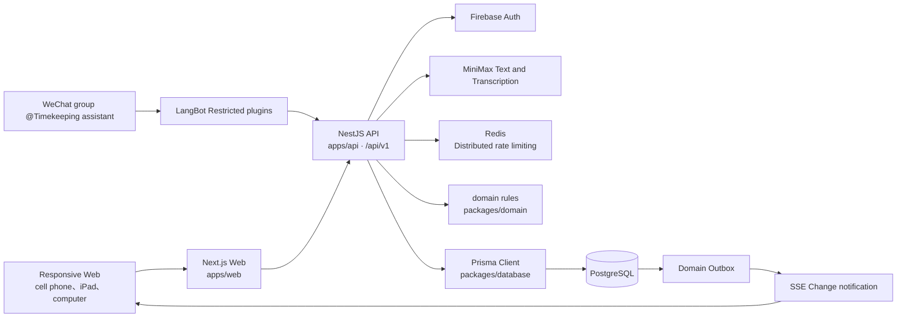

<a id="当前架构"></a>

# Current architecture

**English** | **[简体中文](ARCHITECTURE.zh-CN.md)**

> Verified against version: `1.34.4`
> This article describes the current implementation; a draft design from the beginning of the project can be found in [`archive/INITIAL_ARCHITECTURE_PLAN.md`](../archive/INITIAL_ARCHITECTURE_PLAN.md).

Massage note is a TypeScript modular monolith managed by the pnpm workspace. Web, API and shared packages are developed and tested in the same repository. Production can be run as a Web/API dual container or simultaneously in a Synology single image.

<a id="系统全景"></a>

## System panorama



Core principles: PostgreSQL is the source of business truth; SSE only notifies the client to re-read REST; AI only generates candidate parameters or interprets deterministic query results.

<a id="仓库边界"></a>

## Repository boundary

| Path | Responsibilities | Not Responsible | Reason |
| --- | --- | --- | --- |
| `apps/web` | Next.js App Router, responsive Chinese and English UI, API client and local draft | Final permission judgment, final financial calculation | Client-side presentation cannot grant permissions or determine the final amount. |
| `apps/api` | REST, authentication, authorization, transactions, domain orchestration, auditing, outbox, SSE and AI gateway | Browser display status, any SQL AI tool | Server-side coordination of authorization and transactions for multiple clients. |
| `apps/messages-agent` | Fixed picking individual daily statement and employee interval settlement tasks on Mac, rendering attachments, restricted staging and calling Messages AppleScript | Inbound port, chat database reading and writing, keyboard/window automation | Native permissions App and outbound picking are existing sending paths. |
| `integrations/langbot-plugin` | Intercept specified WeChat group work record messages, limit parsing intent and call dedicated work record interface | Directly read the database, determine prices/employees, call other business interfaces | The model only generates limited intent, and financial facts are determined by the backend. |
| `packages/domain` | Business day, permissions, commission, amount and financial pure functions without framework dependencies | Prisma, HTTP, React, environment variables | Pure functions can be reused in multiple entries and verified independently. |
| `packages/contracts` | Zod request contracts and types shared by front-end and back-end | Database access, business side effects | Shared verification avoids the calling end from defining a set of inputs. |
| `packages/database` | Prisma schema, client generation, forward migrations, and database constraint testing | HTTP or UI logic | Persistent structures and migrations need to have a unified version history. |
| `docker` | PostgreSQL initialization, running account hardening and NAS entry | Apply business rules | Running identity and startup sequence belong to the deployment boundary. |
| `scripts` | Test database preparation, version and document link checking, backup, recovery, maintenance and offline images | Online request processing | Maintenance commands cannot be mixed with online transactions. |

The dependency direction remains as "Application Depends on Shared Package": Reason: Shared packages must be reused by multiple applications, and reverse dependencies will bind frameworks or databases.

```text
apps/web ────────> packages/contracts
apps/web ────────> packages/domain
apps/api ────────> packages/contracts
apps/api ────────> packages/domain
apps/api ────────> packages/database

packages/domain     Not dependent on applications or databases
packages/contracts  only rely on Zod
```

Historical attendance hidden reuse `DailyEmployeeRow.isHidden`: `BoardsService.updateRow` identifies history by the current date of the device, switches within business day locks and version transactions, allows closed historical days and retains empty rows, shifts, work records and settlement snapshots. The daily closing lock and blank line removal rules are still followed today/in the future. `DailyRankingService.rank` and weekly template automatic rotation only query the visible history and generate explanations based on visible row positions; today's initialized order needs to be actively regenerated, and future automatic refreshes will continue to retain manual ordering. Reason: Attendance basis and closed financials are in different statuses, and historical correction cannot rewrite accounts or manual sequences.

<a id="web-结构"></a>

## Web structure

The current public routes only have the following pages. Stores and business day are mostly expressed through query parameters and page status. The `/s/[storeId]/...` route in the old design is not used:

| Path | Entry Component | Purpose |
| --- | --- | --- |
| `/` | `massage-note-app.tsx`, `today-board.tsx` | Today/history business day, work record, gift card sales and customer records |
| `/finance` | `finance-page-client.tsx` | Summary, details, daily closing, cash and salary settlement |
| `/manage` | `manage-page-client.tsx`, `manage/members-panel.tsx` | Shop, members, directory, commission, recycle bin and audit; member operations use independent native dialog, draft and real-time lists are held separately |
| `/profile` | `profile-page-client.tsx` | Profile, password, store switching and session exit |
| `/login` | `login-form.tsx` | Mobile verification code, password and controlled development login |
| `/assistant` | `assistant-page-client.tsx` | Compatible with old bookmarks; the main entrance is the business page floating assistant |
| `/help`, `/offline` | Page components | Chinese and English help and disconnection instructions |

The date interception and UTC date addition and subtraction reused internally in the financial page are placed in `apps/web/app/finance/date-utils.ts`.

Web only builds Next standalone products, `prepare-standalone-web.mjs` complements static resources, and Docker runs the same `server.js` as the local production entrance. Reason: The current build, startup and deployment links all rely on standalone, and the old `WEB_STATIC_EXPORT` branch does not have a corresponding delivery entry.

Web visuals are loaded in order of `globals.css` (basic rules and color variables), `design-system.css` (shared visuals and light animations), `responsive.css` (breakpoint layout). `app/ui/primitives.tsx` reuses SVG icons, brands and indicators; `app-nav.tsx` uses the same set of menus to present the desktop with automatically shrinking sidebars and small screen bottom bars, retaining store parameters and navigation height measurements. Only 64px is reserved for the main desktop area. The sidebar expands to 216px and covers the content through CSS hover or `:focus-visible`. Mouse click focus will not make it permanent. `lib/app-navigation.ts` unifies the role menu, `use-navigation-tab.ts` synchronizes URLs and page partitions; desktop finance and store settings parent items use buttons to switch subdirectories independently, and are collapsed by default; subitems retain native deep links, and only ordinary clicks on the current page use partition callbacks. The small screen parent is still a page link and uses page tags. The member page uses `manage/members-panel.tsx` to organize the employee directory, file selection and confirmation form. `lib/member-management.ts` verifies the complete draft and then submits the information and commission version interface in sequence; the DOM process test uses React/jsdom without starting the browser. The appearance of the work record auxiliary module is maintained by `.board-panel`, and the title and content of the member fieldset are laid out separately; `scripts/check-ui-styles.mjs` checks the color/rounded variables and breakpoint coverage boundaries. For the design basis, see [UI Design](UI_DESIGN.md). Reason: The actual entry, style cascading and life cycle have public implementations, and repeated implementations will lose consistency.

`apps/web/lib` contains shared client capabilities:

- `api.ts`: API base address shared by login, business requests and real-time connections, as well as unified cookie requests, idempotency keys, error translations and directory name registration.
- `i18n.ts`: interface entries, stable error code translation and custom project name mapping.
- `types.ts`: Some handwritten response types; roles, weekly schedules and settlement scopes reuse domain/contract types, and the rest of the responses must be synchronized when changing. Reason: The actual entry, style cascading and life cycle have public implementations, and repeated implementations will lose consistency.
- `money.ts`, `time.ts`, `closing.ts`, etc.: UI-less display and status helper functions and tests.
- `svg-png.ts`: individual daily statement shares SVG loading, canvas capacity limit, PNG conversion and temporary URL recycling with interval settlement; each entry retains device scaling, file name and return type. Reason: Only one location is maintained for the same conversion and failure processing, and the exported content and financial amounts are still provided by the shared SVG template and server.
- `realtime.ts` / `realtime-client.ts`: Sharing SSE connections on the same page and in the same store, serially merging REST reloads; the heartbeat pauses for 10 seconds to rebuild the connection, supplementary reading every 30 seconds during abnormal periods, paused when hidden or offline, complete supplementary reading when visible/connected again. `realtime-scope.ts` selects the refresh scope by entity and business day; changes in employee rows/tables of earlier dates also refresh the subsequent dates being viewed, and future automatic scheduling will use the latest attendance accordingly, and today's initialized order will be retained.
- `business-date-calendar-cache.ts`: The home page holds a memory cache grouped by store/month, up to twelve months, merges in-transit requests of the same month, and retains them by remounting across tables; reuses calendars, directories, and member data when cutting dates, and re-reads the target table. Local business operations, manual refresh and cross-day cache clearing; automatic synchronization and complete re-reading of the network only refresh the business data, do not re-obtain the read calendar, mark changes caused by other devices are updated after manual refresh; old requests cannot backfill the invalid cache. New panel subscriptions to SSE only initialize themselves and do not trigger complete re-reading of subscribed homepages. The cache is not written to the browser storage, the store is reinitialized, and the financial calendar is read when it is opened. Reason: The actual entry, style cascading and life cycle have public implementations, and repeated implementations will lose consistency.

Browser local storage only saves language, current store preferences, and up to seven days of unsubmitted draft details; no Service Worker is registered, and no browser installation entrance is provided.

<a id="api-模块"></a>

## API module

`apps/api/src/app.module.ts` combines the following modules:

| Module | Main Responsibilities |
| --- | --- |
| `auth` | Firebase ID tokens, passwords, CSRF, session cookies and revocation |
| `users` | Current user information and password update |
| `stores` | Stores, members, membership requests, catalogs, commissions and store access checks |
| `boards` | business day, shift, daily table row and daily opening ranking |
| `work-records` | work record snapshot, payment confirmation, soft deletion and recovery |
| `gift-cards` | Sell cards, serial numbers, discount snapshots and usage ledgers |
| `lost-customers` | Time, number of passengers, remarks, Walk-in source and audit snapshot |
| `work-bot` | WeChat robot group/employee binding, restricted intent submission, query and management |
| `finance` | Financial inquiries, daily closing, cash settlement and payroll ledger |
| `audit` | Query immutable audit logs by store |
| `realtime` | SSE event streaming for PostgreSQL outbox |
| `ai` | work record previews, conclusive financial explanations and short recording transcriptions |

The amount parsing and reply formatting of `work-bot` are placed in `work-bot-format.ts`, and the Service retains permissions and transaction orchestration. The XML escaping, amount and time display of the generated image are shared by `packages/domain/src/image-format.ts`, and the theme, line wrapping and surface drawing of salary settlement and individual daily statement are shared by `image-layout.ts`. Range settlement pure SVG layout in `employee-settlement-image.ts`, Web converts PNG natively and previews/saves, Mac proxy converts size-limited JPEG for sending. Individual daily statement Pure SVG layout is located in `employee-closing-image.ts`, with a fixed 1170 pixel source width; Web `lib/employee-closing-image.ts` retains device pixel adaptation and sharing/downloading, and Mac `src/render.ts` converts PNG via `sips`. Both ends read the same snapshot by object and date, recognized revenue, source grouping and chronological breakdown, and the employee subtotal still has its own rendered layout. Daily closing and interval settlement send share the certificate hashing and authentication of `finance/delivery-agent.ts`, the receiving number verification of `delivery-recipient.ts`, and the lease conditions and failed retry status of `delivery-lease.ts`; each Service retains object query, lease review and business transactions. Reason: Sharing pure typesetting avoids bifurcation of web and SMS content or aesthetics. The image conversion and sending environments retain their own boundaries. The final permissions and amounts are still controlled by the server.

The Controller is only responsible for HTTP adaptation and shared contract resolution. Permissions, object ownership, status, and transactions are placed in a Service or domain function; the final value of the amount does not trust the front-end total. Reason: The final judgment of authority and amount must be made on the server side and cannot be achieved by interface or client parameters.

<a id="典型写入链路"></a>

## Typical write link

```text
Web form
  → packages/contracts Zod check
  → Nest Controller
  → Session, store member and role checks
  → Idempotency-Key / version / business day lock
  → Prisma transaction
      ├─ Business data or snapshot
      ├─ audit_logs
      └─ domain_outbox
  → JSON security response
  → SSE Notify other devices to reread REST
```

The work record, form, daily closing and cash settlement of the same store's business day use the transaction-level advisory lock of `common/business-day-lock.ts`. Modifiable resources use `version` optimistic locking, and key writes use `Idempotency-Key`; batch processes must also maintain auditing and outbox transactions with business data. Reason: Concurrent writes, closing and batch operations must maintain the same lock and transaction boundaries.

<a id="占位数据流"></a>

### Placeholder data stream

The fast work record placeholder reuses the date, employee, sequence time, version and soft deletion fields of `WorkRecord`, and determines them separately by `PLACEHOLDER` status, without adding zero-dollar items or payment snapshots. Create the requested `isPlaceholder: true` branch to skip items, commissions, discounts and cash settlement fallbacks, updates and payment entries are explicitly rejected; delete recovery reuses original permissions, business day locks, idempotency, auditing and outboxes. The database only adds forward migration of enumeration and placeholder field constraints, and existing records remain in their original state. Reason: Persistent tags need to be reused across device and recovery boundaries and cannot be mixed into accounts.

Kanban reads placeholders and protects its employee rows, statistics and calendar aggregation are excluded; finance, payroll, daily closing, business analysis, robots and AI work record contexts exclude placeholders when querying the data source to avoid the binary payment status from mistaking the new status for paid or pending settlement. Web renders two SVG diagonal lines covering the entire card and the formatted selected time separately before the normal card branch, and uses a dedicated delete confirmation pop-up window. Reason: Card locations and service facts have different consumption ranges, and source filtering avoids false work numbers, wage changes, and job occupancy.

<a id="财务与历史数据"></a>

## Financial and historical data

- The persistent amount uses integer cents; the final calculation of the domain layer uses `bigint`, and the commission uses basis points. Reason: Integer cents avoid floating point errors, and cents are used to accurately express commissions.
- The formula fact source is `packages/domain/src/finance.ts`, the amount formatting is not the ledger calculation. Reason: Formatting only changes the display and should not produce a second set of accounting algorithms.
- When the work record is created, it saves the project, duration, price, discount, commission and source, salary, time zone and business day deadline snapshot. Reason: History reading depends on the content when it occurs, not the current directory.
- Modifying the directory or commission cannot overwrite the closed historical days; the allowed recalculation of the current business day must go through the server-side process. Reason: Amounts, payment ledgers and historical snapshots have their own origins and cannot be replaced by formatting or the latest settings.
- Daily closing, cash closing and payroll closing are different ledgers/states and should not be combined into one overridable total. Salary registration uses `PayrollEntryForm` to unify employees, date ranges, amounts and salary sources; calendar payments use `EmployeeSettlementPaymentsService` to calculate the outstanding amount and revision, obtain relevant business day locks in the Serializable transaction, verify revisions and save the actual payment ledger, audit and idempotency results. `PayrollSettlementConfirmation` associates the ledger one-to-one, and only saves the outstanding amount and manual deduction at the time of confirmation. The employee, scope, source and soft deletion status are read from the parent ledger to avoid modification/restoration desynchronization. Domain function `settlement-calendar.ts` consolidates scope confirmation and daily cash income; documents/text messages continue to use the complete work record snapshot. Manual and historical payroll ledger does not infer settlement confirmations, old sources remain unknown. Reason: Amounts, payment ledgers and historical snapshots have their own origins and cannot be replaced by formatting or the latest settings.
- For detailed product specifications, see [`PRODUCT.md`](../product/PRODUCT.md).
- `AnalyticsDailyReport` reuses its existing daily-subtotal request to provide the overview and income chart with amounts from the same scope. Overview and period bars share daily amount aggregation without recreating financial formulas or adding requests. Average curves and the calendar form the main area; other analysis and subtotals stay below. Reason: overview, charts, and breakdowns must use server facts under the same filters.

<a id="认证安全与隔离"></a>

## Authentication, security and isolation

- The production authentication link is Firebase Phone Auth or password exchange for Custom Token. Finally, Firebase ID token is used to establish a server-side `HttpOnly` session. Reason: Both logins must ultimately accept the same session and revocation checks.
- Cookie write request verification is accurate `Origin`; there is also double submission of CSRF during login initialization. Reason: Cookies will be carried automatically, and writing requires additional verification of the request source.
- Each business service revalidates active members, role capabilities, object `storeId` and business day status. Reason: Effective membership and object ownership together enforce current tenant isolation.
- The database migration account is separated from the application account; the application account cannot DDL, nor can it rewrite audit, AI log, and outbox history. Reason: The current member, object scope, and running account are the current isolation mechanisms.
- PostgreSQL RLS which relies on connection session variables is not currently used; see [`SECURITY.md`](../operations/SECURITY.md) for the complete boundary. Reason: Connection pooling does not have request-level session variable guarantees, and the old RLS plan does not represent implementation.

<a id="运行与部署形态"></a>

## Operation and deployment form

| Scene | Form |
| --- | --- |
| Local development | Next.js `:3000` + NestJS `:4000` + Docker PostgreSQL/Redis |
| Ordinary production Compose | Independent `web` and `api` containers, the port is only bound to loopback |
| Synology | A `nas` application image starts Web/API at the same time; Next.js proxies `/api/*` to the API in the container |
| Fixed Mac | LaunchAgent only issues HTTPS requests to the NAS and reviews the sending lease; uses LaunchServices as the same FDA-authorized interfaceless App to temporarily store and read verified PNG/JPEG, and executes the packaged AppleScript in the App to send attachments silently; App only reads the local sending status metadata of the precise task; local started/submitted/accepted checkpoint and collection time protection receipt interruption, pending recovery and failure back-off, do not simulate interface operations |

The one-shot `migrate` service applies database migrations, followed by `harden` to restrict the application account. CI checks versions and documentation links, tooling, types, unit tests, database/API integration tests, and production builds on push/PR. Successful `main` verification publishes `linux/amd64` NAS images.

<a id="修改位置速查"></a>

## Edit location quick check

| Change type | Primary position | Must be linked | Reason |
| --- | --- | --- | --- |
| Financial formula | `packages/domain/src` | domain testing, API query, product documentation, UI description | The calling end must use the same account definition. |
| Request fields | `packages/contracts/src` | Contract testing, Controller, Service, Web type, API documentation | Multiple callers must use the same contract. |
| Data model | Prisma schema + new migrations | Constraints/integration tests, services, deployment instructions | Existing databases require a replayable upgrade path. |
| Permissions | `packages/domain/src/permission.ts`, `store-access.service.ts` | Normal, override and cross-store integration tests | Override and cross-store failures should also be verified. |
| Page behavior | `apps/web/app` | Chinese and English, mobile/iPad/desktop and interactive testing | Shared business processes in different languages and widths. |
| Real-time events | Write transactions, outbox, `realtime` | REST reload and disconnection recovery | Events only notify the re-read business truth. |
| AI | `apps/api/src/ai` | canonical preview, confirmation authentication, rate limiting and security downgrade | Canonical preview cannot skip confirmation and permissions. |

See [`DEVELOPMENT.md`](DEVELOPMENT.md) for the specific development and verification process, and see [`API.md`](API.md) for the HTTP endpoint.

<a id="ai-会话上下文"></a>

## AI conversation context

`AiConversation` binds store, user and assistant types; `AiQueryLog`'s existing JSON result fields save replies, query results, previews and member permissions without database migration. Each request with `conversationId` first verifies the ownership, then reads the non-ERROR history, and hands it to the model supplier in order of role and time; the work record read-only tool keeps the same history in a loop. Role/member scope changes exclude results from the previous scope. Reason: History only assists understanding, business results and writes must still be read and authenticated again.

When the financial assistant has history and the model is available, it first analyzes the current complete filter based on the history, then calls the back-end financial service and interprets the latest statistics. History only helps to understand the inquiry and cannot replace business authentication, deterministic calculation or write confirmation. For interface details and old log compatibility restrictions, see [API Documentation](API.md). Reason: History only assists understanding, business results and writes must still be read and authenticated again.

Individual daily statement text messages use an independent business day and an empty daily closing cycle, and snapshots can be saved and sent even if they are not closed; individual "closed cash" reuses the DailyCashSettlement and the original audit/outbox path.

<a id="日结定时任务"></a>

### Daily closing scheduled task

`ClosingSchedulerService` starts and stops with the API, scanning active stores every 15 seconds, and only calls the internal automatic mode of `ClosingsService.close` at 23:30 minutes in the store time zone; running scans do not overlap, and failures in each store do not block each other. The task is executed with the store owner's valid account, and the audit source is `scheduler`, which is not affected by the browser device time. Skip if there is no valid store owner account.

Automatic mode checks all exceptions and existing daily closing cycles within the business day advisory lock; deterministic idempotency key plus business day lock supports repeated scans and multiple API instances. The first daily closing creates a personal summary snapshot, sends tasks and audits in the same transaction, and the audit trigger generates an outbox simultaneously. Eliminate duplication of shop, business day, and member checks SENT/QUEUED/CLAIMED, and cover manual sending of unassociated daily closing. No new database migrations or external cron services have been added.

<a id="实时同步资源与恢复"></a>

### Real-time synchronization of resources and recovery

Each API instance shares a 2-second outbox poll per store (the number of event queries does not increase with the number of connections), and each subscription still independently checks member and account permissions. Shared streams are not deduplicated by account; polling is released when the last connection leaves, and all streams are released when the instance is closed. New subscriptions require full REST synchronization immediately, and the original `Last-Event-ID` is still compatible; when the same store already has a shared cursor, full synchronization is used to complete the state before joining. Keep notifications of late-committed transactions every 30 seconds. Reason: Shared polling cannot weaken independent connection permissions, and REST failures and drafts must be handled separately.

The browser will only show synchronized if it receives the actual event/heartbeat and the REST read is successful. Continuous notifications are merged within a 250 millisecond window. Changes received during reading will be queued for supplementary reading; failed reads will be retried at low frequency even if the heartbeat is normal. The known work record/table events on the work record page only re-read the table on the selected date, the financial page re-reads the relevant summary, details and settlement, and the management page only updates the deleted work record list; unknown events and reconnections are still completely refreshed. Do not remount the work record editor, retain drafts and version conflict verification. Reason: Shared polling cannot weaken independent connection permissions, and REST failures and drafts must be handled separately.

Work record shares the automatic discount judgment of `apps/api/src/common/automatic-discounts.ts` with robot work. Reason: The same discount snapshot should be generated for the same store, business day and amount to avoid two portals maintaining separate rules. `WorkRecordsService` excludes the automatic discount of highlight work records when creating and editing, and the robot highlight operation reuses the editing service; the Web details preview is synchronously excluded, and manual discounts and single-transaction manual deactivation are retained.


<a id="business-analytics--经营分析"></a>

### Business analytics / business analysis


`FinanceAnalyticsService` extends its existing RepeatableRead read transaction with the latest closed date at or before the selected end and narrow record/sale projections for the preceding 60 calendar days. `calculateFinanceTrends` derives adjacent 7/30-day comparisons independently of the selected start, using only closed-date samples and the current highlight filter. It reuses `calculateRevenue`, `calculateStoreIncome`, and `calculateStoreSettlement`, aggregating fee inputs once per window. Fractions stay unrounded until comparison/display. `FinanceAnalyticsResponse.trends` contains the cutoff, period ranges/counts, values, statuses and changes. `AnalyticsOverview` consumes it directly in the panel, independently of daily subtotal loading, with the existing analytics refresh queue and stale-scope guards. No migration or extra HTTP request is introduced. Reason: consistent fee rounding and isolated request lifecycles preserve reliable trends without loading full summaries for every window.

`FinanceAnalyticsService` Verify the store's financial permissions in the RepeatableRead read-only transaction and read the current store's valid work record, walkout, card sales and closed date after deduplication. The same transaction reads the valid work record and sales card of the whole store, and the work record revenue is passed uniformly. `calculateRevenue` The post-discount performance is calculated minus the gift card service fee, and actual receipts are calculated separately for card sales. The same formula is used for billboards, calendars, and financial averages. Turnover and store revenue retain the original write-off amount to prevent gift card services from being deducted again. Negative revenue and mean values use signed cents rounding, historical wages and daily closing/sending snapshots are not rewritten. Independent within the service `highlightFilter` Filter ordinary charts and moving average windows, only highlight excludes store-level sales cards, and the running and daily closing samples are not affected; the default starting date is determined by the earliest valid business/daily closing in the whole store.`calculateWeekdayRevenueComparison` Three groups of weekly average and daily amounts that are not affected by highlight filtering are returned from the same batch of data. The three groups share the closed denominator. Only non-highlight and all are entered for selling cards. They are first totaled and then rounded separately. The daily work record quantity response also includes valid guest records. `customerCount` summative `lostCustomerCount`; Dates with only runners but no work record are also included in the date sequence. domain function `calculateFinanceAnalytics` Responsible for historical time zone hour grouping, natural day zero padding and integer cent averaging. The 30-day window padding is 29 days before the start date, the seven-day window is retained for 6 days, and the full-date cumulative average only starts from the selected start date; sharing contract `FinanceAnalyticsResponse` Only aggregated results are transferred. Web-independent analytics tags are loaded on demand, merging events through existing real-time channels and refresh queues, and invalidating old requests after cut-off, date/highlight condition changes, and unloading. `AnalyticsDailyReport` Put the revenue calendar into the same grid as the subsequent charts, keeping the daily subtotals at the end;`AnalyticsIncomeBars` Reuse the same summary state through rendering functions,`groupIncomePeriods` Only total the three calculated daily amounts based on day/Monday to Sunday/calendar month, trim the beginning and end of the range and retain negative values, and do not add new requests or rebuild financial formulas;`AnalyticsAverageRevenue` Three means and sample numbers on the consumer server,`Chart` Maintain the complete date axis and not-yet-closed gap of the line chart through the container width and bounded Bezier curve; all column charts reserve column spacing according to the complete value label, and only scroll within the chart when it exceeds the container. Negative labels are placed at the end of the negative column, and the number of runners and work records are marked separately.`AnalyticsWeekdayRevenue` Always display highlight, non-highlight, all three columns and daily tables of the same definition, without adding comparison requests.`AnalyticsDailyReport` Reuse the date boundary of the response with the highlight condition to read the existing financial summary and daily details;`AnalyticsRevenueCalendar` Directly display the filtered `days [].revenueCents` And continue to use today’s work record style, and the unfiltered data will not be obtained when the month is switched. Daily subtotals and details adopt independent refresh queues and expired response isolation, and the detail elastic layer and financial summary are shared `FinanceDetailsDialog`. Walkout data is maintained by independent database tables and forward migration; optional comments are saved in `LostCustomer.note`, go directly to the store source and save it in `LostCustomer.isWalkIn`(Old records and new defaults `false`); both are returned with the list and audit snapshot, and do not enter the quantity or amount calculation. Reason: The aggregation is read based on historical dates and snapshots, the display cannot be recalculated at that time, and the expired filter results cannot overwrite the current chart.

The daily opening ranking is generated by the domain layer `explainRotationCandidates` reuse sorting function to generate a structured comparison basis, and the API and the final order are transactionally saved to `daily_boards.ranking_explanation`. Reading uses shared contract verification and restricts management permissions. The Web displays snapshots and current list differences in fixed Chinese and English text, without relying on AI or current history recalculation. Use forward migration for new fields, and existing sorting snapshots are empty.

<a id="每周排工与折扣目录"></a>

## Weekly schedule and discount catalog

The weekly schedule template is saved in the store, and the business day table records the first time the mark is applied. Before loading the Kanban board, the template personnel are added into the business day lock through API, and the existing rotation ranking explanation is generated and audited and outboxed. When loading the future date, the automatically added rows are synchronized according to the latest template and the order is recalculated. No changes are written. The personnel and manual adjustments that have been arranged today are retained. Future Kanban Basis `board.rows_reordered` / `board.rows_ranked` audited `afterJson.version` Determine the latest sequencing operation to avoid misjudgments caused by the same millisecond time or UUID order; after manual sequencing, only the list is synchronized, new personnel are appended to the end, existing personnel are not rearranged, and automatic sequence updates are resumed after active regeneration. Reuse existing audits without adding new database fields or migration. The weekly template takes effect immediately, and you can view it today and tomorrow; historical and closed boards are not applied. Manually remove the most recent data based on the business day on a single day `board.row_removed` / `board.row_added` The member ID exclusion template in the audit snapshot is automatically filled in, and manually re-added to remove the exclusion; the same audit definition is used to hide empty rows and remove them. Reason: Audit and settlement snapshots save manual intentions and payroll facts, and loading cannot overwrite the history.

The pop-up "Apply" uses `replace-weekly-dispatch` to overwrite the selected date with the current check and does not save the template; when the target date already has a work record (including pending checkout or deletion history), is closed, or belongs to history, it is rejected and rolled back. The override flag allows subsequent automatic loading of manual results that retain that date. Reason: Audit and settlement snapshots save manual intentions and payroll facts, and loading cannot overwrite the history.

`discount_items.rate_bps` is a nullable ratio; preset discounts and custom discounts reuse existing work record ratio snapshots and field amount calculations. The gift card ledger is added to the old cards without sales registration from the confirmed work record according to the standardized serial number group, and the query does not generate a sales account. Online card sales are distinguished by `GiftCardSale.isOnline`, and the user name reuses the `serialNumber` text field; payments are saved in work record and payment snapshots as `giftCardIsOnline`. The unique index of physical cards only covers valid physical cards, and the server continues to check the deletion history of physical cards; user names allow repeated purchases, are not assigned physical numbers, and are not associated with system users. The ledger `onlineAccounts` is grouped for purchase and use according to the original user name after removing the leading and trailing spaces, to avoid mixing and repeated write-offs of physical cards with the same number.


Member `StoreMembership.dailySettlementEnabled` defaults to false. Daily full settlement continues to use the business day lock, version, idempotency and audit of `CashSettlementsService`. The settlement snapshot is stored in `DailyCashSettlement`. Extra wages and non-cash tips are saved separately. The original cash collection/retention fields retain their respective meanings. The amount is calculated by domain `calculateDailyFullSettlement`. Cash tips do not enter the handover amount but are included in the employee's income; only the additional paid part is added to the salary balance to avoid repeated deductions of cash wages. The payroll calendar merges valid daily full settlement snapshots to confirm both sources; it automatically rolls back to the original state to invalidate the snapshot without writing back to an independent payroll ledger. The closed snapshot does not read subsequent member settings; during the settlement period, member shared row lock serialization settings are updated, and existing salary confirmation and pending work records prevent the full daily closing. Reason: Audit and settlement snapshots save manual intentions and payroll facts, and loading cannot overwrite the history.

<a id="店铺支出数据流"></a>

## Store expenditure data flow

The financial `expenses` tag uses an independent `ExpensesPanel` to request by store and natural month; reuse LatestRequest, refresh queue and real-time subscription. Invalidate old requests when switching months/stores or uninstalling. The `expense_item` event only refreshes expenditures, avoiding rechecking income and daily closing.

The ExpensesController/Service of `FinanceModule` accepts operations through the shared expenditure contract and checks the store owner/manager permissions and store ownership with `EXPENSE_MANAGE`. The database adds ExpenseItem, ExpenseRuleRevision, and ExpensePeriodOverride; the project version is a unified optimistic lock for rules and single-period coverage operations, and the version, business data, and audit are updated in the same idempotency transaction, and the existing audit trigger creates an outbox. Expenses do not lock the business day and do not rewrite the daily closing snapshot.

Field `calculateExpenseMonth` uses a BigInt to directly locate the intersecting period by query month, without scanning from the first expense day by day. The monthly cycle uses the whole month as the amortization unit, the daily cycle uses the natural day as the unit, and the remainder belongs to the earlier unit. Single-period modifications take priority; if there is no modification, only the common amount will be used from `defaultAmountFrom`, and empty amounts and missing periods will be returned before. The server simultaneously calculates cycle/one-time totals, daily averages for the whole month, and project totals for the current month; `readExpenseMonth` is responsible for persistent mapping and field calculations after authorization of the expenditure page. Today's dashboard does not read expenditures, and total revenue only totals store and manager service revenue; soft deletion projects do not participate in summary. The front-end only formats the amount and edits the input, combines the display by project, and does not recalculate the monthly cost. Forward migration aligns the first legal cycle boundary of the old budget rule according to the beginning of the store's local upgrade month; the database `amount_mode` is compatible and retained but does not participate in the calculation, and the rule ID, actual bill, cycle history and audit are not rebuilt. Reason: Monthly display, history missing and true zero must come from the same set of service port ports.

The `isDispatchExcluded` of the work record is saved independently by the shared creation/update contract, WorkRecordsService and database. Web drafts and Kanban boards read the same field; `recordTrackItems` sorts it together with the highlight record from right to left in time, `record-card--right-group` only controls right alignment, and `isHighlighted` continues to control the color and amount rules independently. Reason: Separate placement and highlight semantics to avoid scheduling tags that change financial calculations.

The individual daily statement is composed of domain's `employee-closing-template.ts` to unify Chinese and English display content and stable time sorting. Web's `employee-closing-statement.tsx` displays two columns of work record cards. `employee-closing-image.ts` outputs the same SVG and is converted to PNG by Web canvas and Mac `sips` respectively. All income is still taken from the backend snapshot, and the page cash handover/send operation is outside the template. Reason: Shared display content prevents pages, exports, and SMS attachments from evolving separately. The display layer must not recalculate wages or imply that they have been paid.
