# Portfolio gallery and public demo

**English** | **[简体中文](README.zh-CN.md)**

**[Open the sign-in-free demo](https://redonkatonkk.github.io/massage-note/)** · **[GitHub source](https://github.com/Redonkatonkk/massage-note)**

These images show the original application pages in English, using fictional stores, employees and financial records generated in an isolated database. Captured on 2026-10-22. The demo defaults to English and also supports Chinese.

## A one-minute walkthrough

1. Start with the work board: inspect ordinary, highlighted, split-payment and pending-payment cards; open a form to understand the workflow.
2. Open Monthly summary and Analytics to compare periods, moving averages, weekdays and service activity.
3. Explore Daily closing, Payroll, Gift cards and Expenses to follow services into reconciliation.
4. Inspect Team, Services and Data operations, then use the domain calculations, transaction locks, audit and permission tests to discuss the implementation.

## Demo boundaries

- This is a static, read-only build of the original Web pages. The real API computes the snapshot in a fresh temporary database; no developer or production database is copied. The snapshot ends on 2026-10-22.
- No sign-in is required. Saves, deletion, closing confirmation, imports, real authentication, AI calls and message delivery cannot execute. Voice recording and CSV export are disabled in the demo build.
- Default pages, Analytics quick ranges (all time / last 7 days / last 30 days / this month) and all three highlight filters have snapshots. The board includes the last seven days. Other custom ranges or filters may report an unsupported snapshot instead of displaying mismatched amounts.
- Payroll supports the current calendar and the default month-to-date preview with all payment sources. Actual payment confirmation and sending require the full application. Bot bindings, recovery and sending queues also show genuine empty states.
- The demo banner and welcome entrance are portfolio-specific. Images show desktop layouts. Browser use was limited to generating these images; validation uses code and command-line checks.

## Page gallery

### Work board

**[Open page](https://redonkatonkk.github.io/massage-note/)** · Employee rows, service cards, mixed payments and highlighted records.

### Monthly summary

**[Open page](https://redonkatonkk.github.io/massage-note/finance/?tab=summary)** · Month-to-date results, comparable periods and trailing revenue averages.

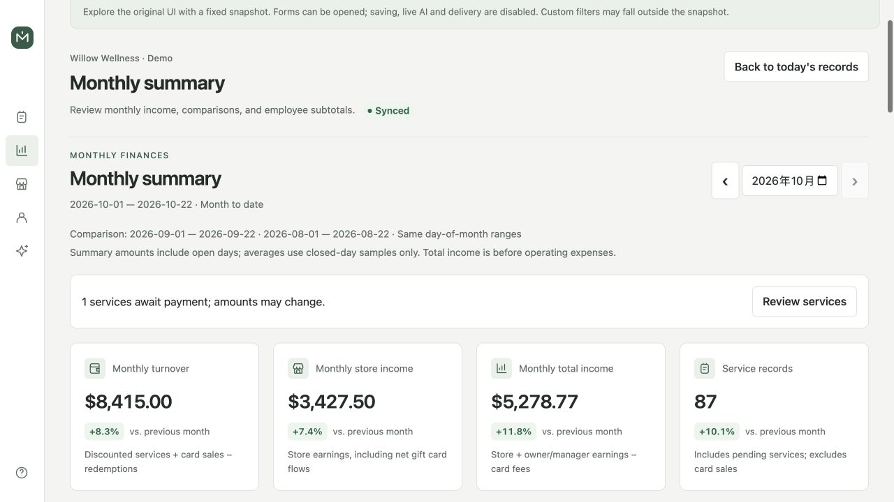

### Business analytics

**[Open page](https://redonkatonkk.github.io/massage-note/finance/?tab=analytics)** · Revenue curves, calendar, weekday comparisons and service activity.

### Daily closing

**[Open page](https://redonkatonkk.github.io/massage-note/finance/?tab=closing)** · Closing checks, employee earnings and cash handover.

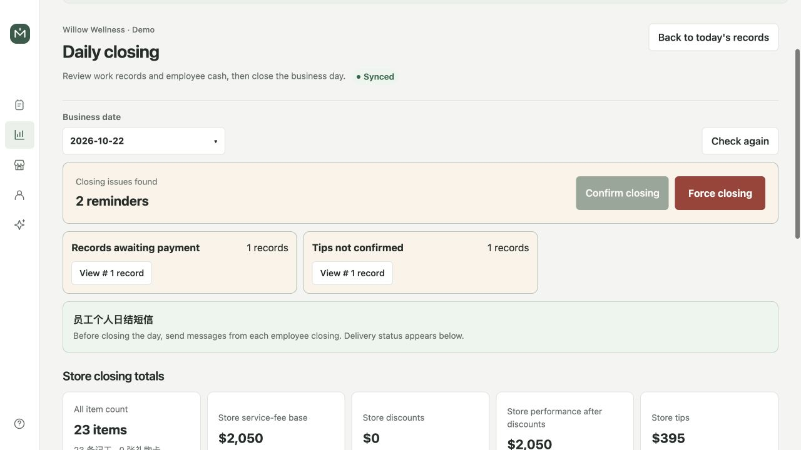

### Payroll

**[Open page](https://redonkatonkk.github.io/massage-note/finance/?tab=payroll)** · Employee selection, settlement calendar and wage ledger.

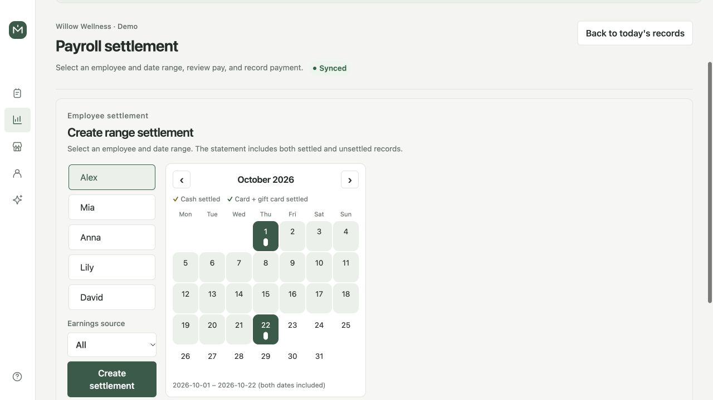

### Expenses

**[Open page](https://redonkatonkk.github.io/massage-note/finance/?tab=expenses)** · Recurring rent/insurance and one-time operating expenses.

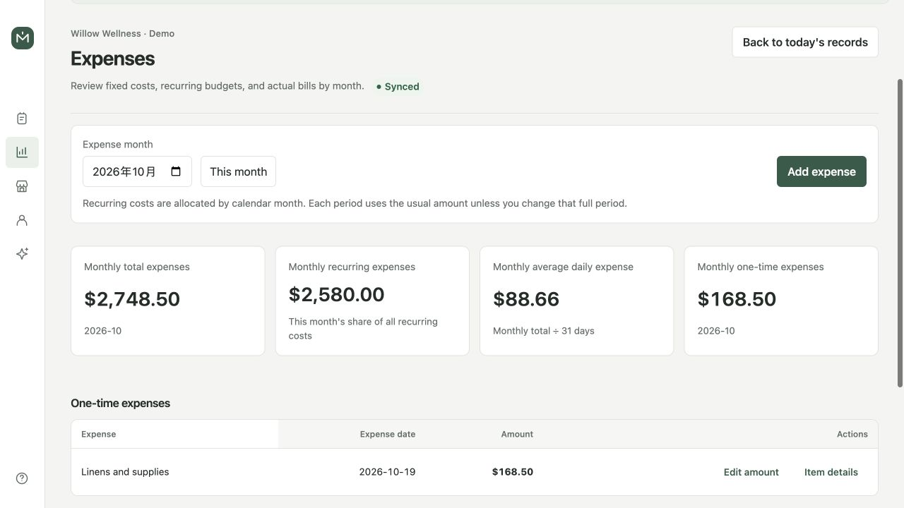

### Gift cards

**[Open page](https://redonkatonkk.github.io/massage-note/finance/?tab=giftCards)** · Gift-card sales, payment sources and redemption history.

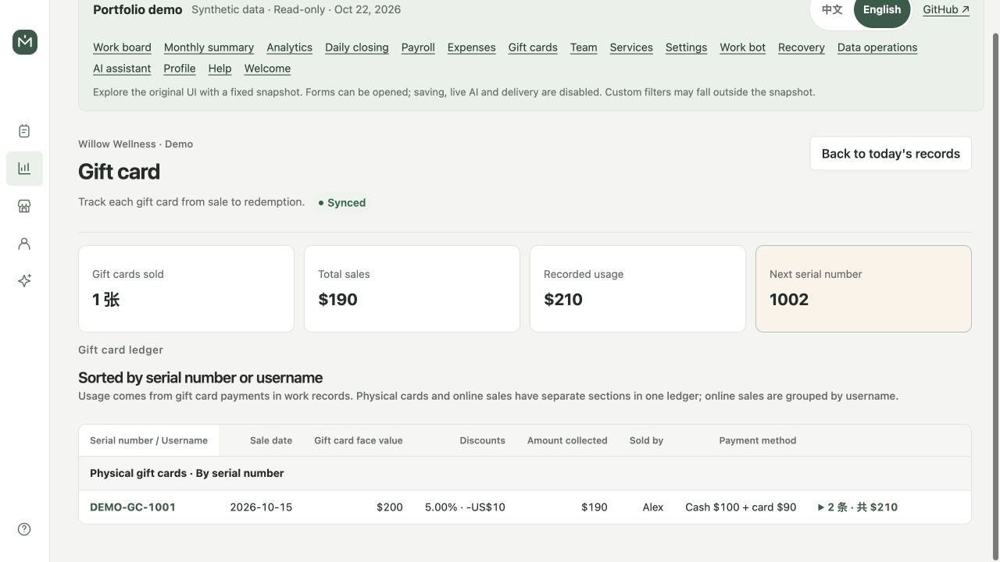

### Team management

**[Open page](https://redonkatonkk.github.io/massage-note/manage/?tab=members)** · Employee directory and individual profile/commission settings.

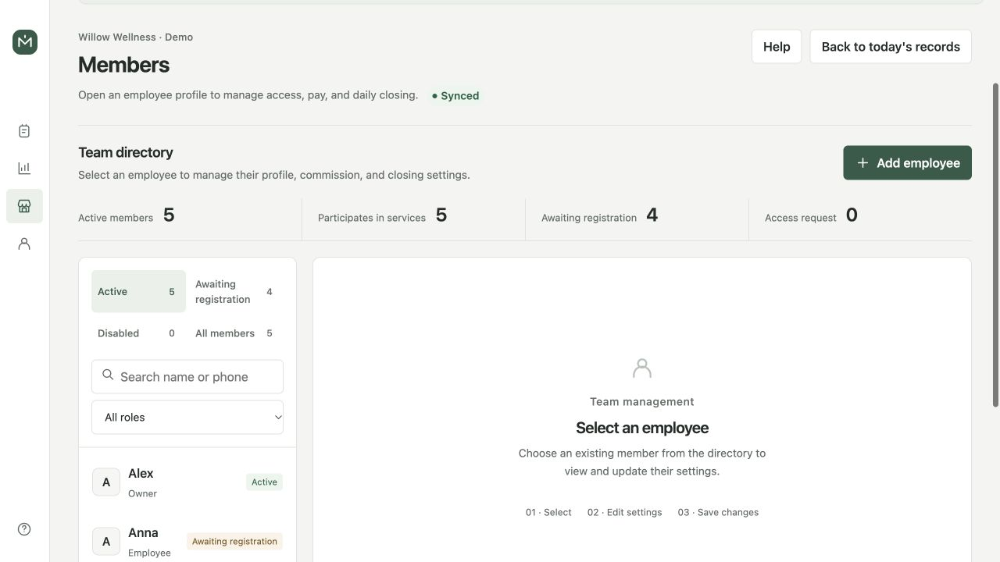

### Services and commissions

**[Open page](https://redonkatonkk.github.io/massage-note/manage/?tab=catalog)** · Service duration/price options, add-ons and discounts.

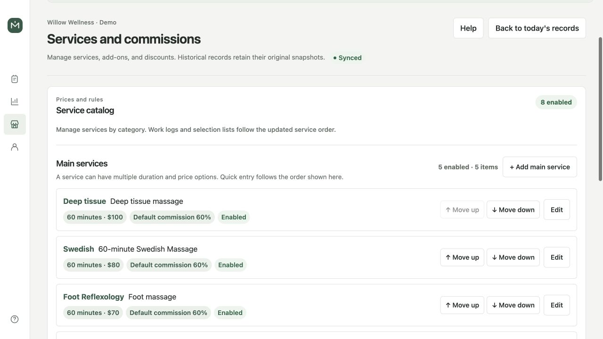

### Store settings

**[Open page](https://redonkatonkk.github.io/massage-note/manage/?tab=store)** · Business rules, commission defaults and integration settings.

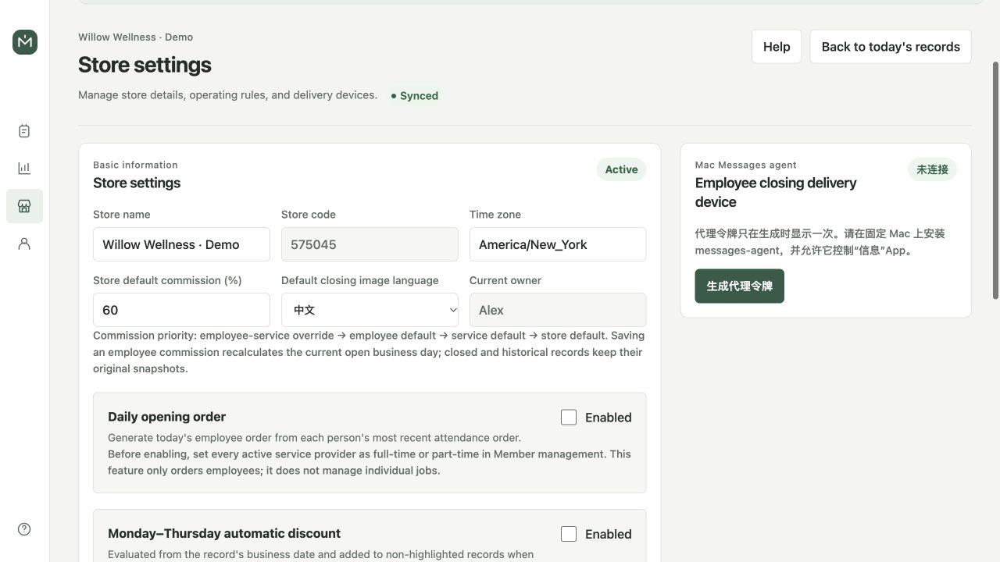

### Work bot

**[Open page](https://redonkatonkk.github.io/massage-note/manage/?tab=work-bot)** · Alias configuration, group bindings and operation history.

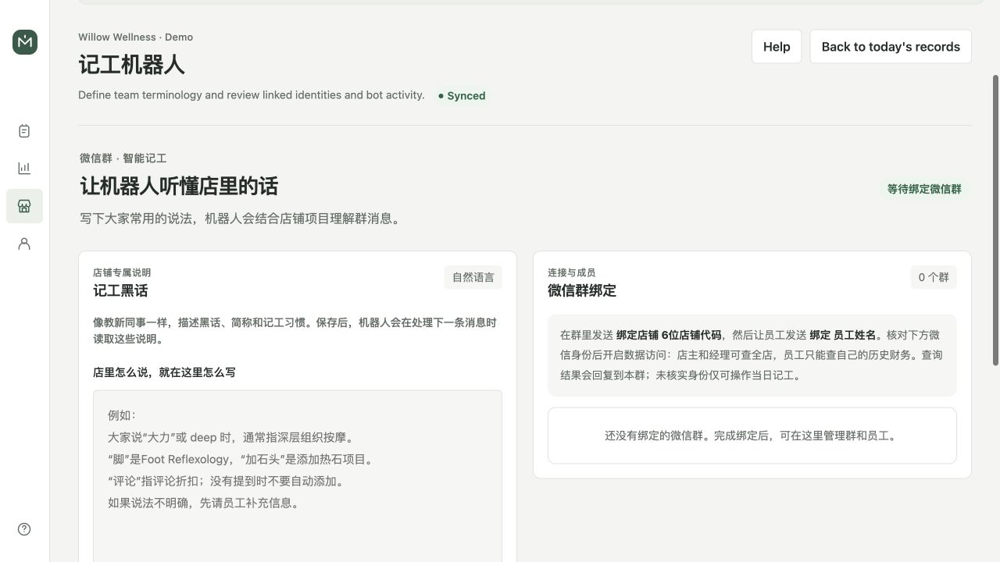

### Recovery

**[Open page](https://redonkatonkk.github.io/massage-note/manage/?tab=recovery)** · Separate recovery lists for deleted work records and gift-card sales.

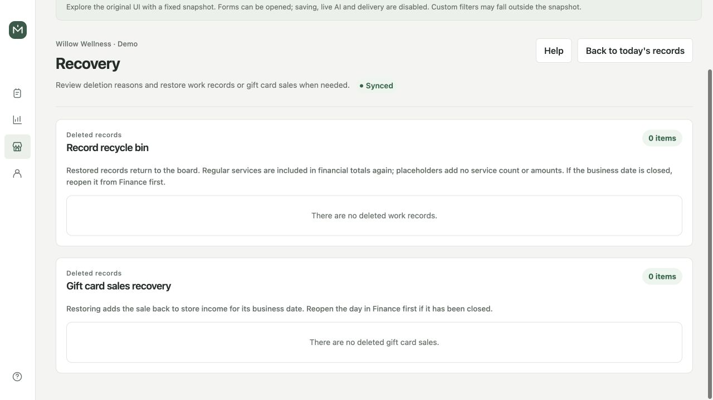

### Data operations

**[Open page](https://redonkatonkk.github.io/massage-note/manage/?tab=audit)** · Store-data import/export controls and audit history.

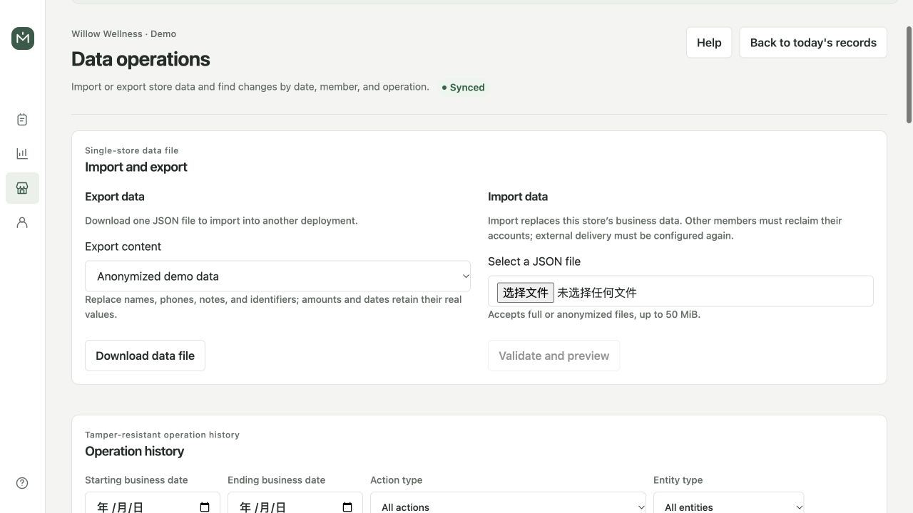

### AI assistant

**[Open page](https://redonkatonkk.github.io/massage-note/assistant/)** · Work/finance conversation UI; live AI and confirmation writes are disabled.

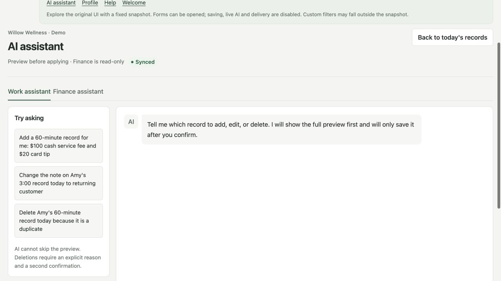

### Profile

**[Open page](https://redonkatonkk.github.io/massage-note/profile/)** · Account details, store membership and account preferences.

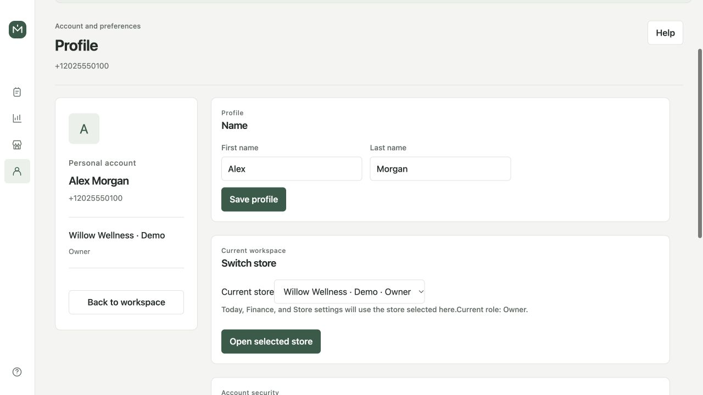

### Help

**[Open page](https://redonkatonkk.github.io/massage-note/help/)** · Expandable guides and financial definitions.

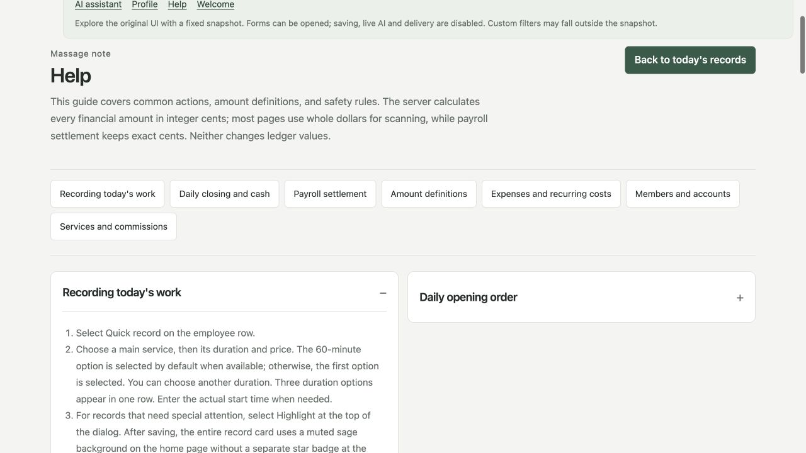

### Demo entrance

**[Open page](https://redonkatonkk.github.io/massage-note/login/)** · Demo welcome state with authentication disabled.

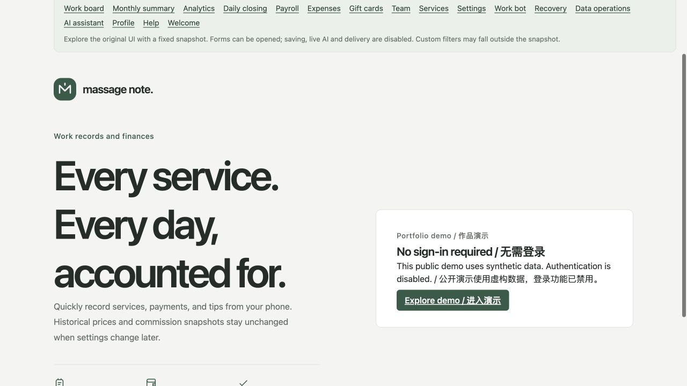

## Suggested resume description

Built a bilingual full-stack shop operations platform with Next.js, NestJS, PostgreSQL and TypeScript, covering split payments, commissions, daily closing, payroll ledgers and analytics, with integer-cent calculations, transaction locks, role permissions and auditable history.

## Maintenance and builds

See the [development guide](../engineering/DEVELOPMENT.md#public-portfolio-demo) for demo builds, data regeneration and the GitHub Pages workflow. Use synthetic data when refreshing images and keep both gallery editions synchronized.
